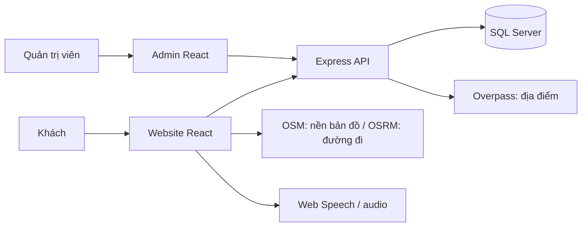

# MUSES — Hệ thống tra cứu tác phẩm nghệ thuật

Đồ án **CNPM_GROUP6** xây dựng website giúp khách tìm hiểu tác phẩm nghệ thuật, đọc và nghe thuyết minh theo ngôn ngữ, tìm bảo tàng đang trưng bày và lập kế hoạch tham quan. Trang Admin dùng để công bố nội dung, quản lý QR trên website và theo dõi hoạt động truy cập.

**Tài liệu yêu cầu sản phẩm:** [PRD hiện hành](docs/prd/PRD.md). Bản này mô tả phạm vi đã được điều chỉnh đến **30/10/2026**, đối chiếu mã nguồn chức năng tại `978b0e0`.

**Sơ đồ phân tích:** [Use Case tổng quát, 21 Use Case chi tiết và ERD](docs/prd/diagrams/README.md) đã được vẽ lại theo phạm vi hiện hành. Hình PNG được chèn trong PRD; có bản SVG và file draw.io để chỉnh sửa.

## 1. Phạm vi đồ án

| Thành phần      | Vai trò                                                                      | Trạng thái                                                                      |
| --------------- | ---------------------------------------------------------------------------- | ------------------------------------------------------------------------------- |
| Website khách   | Tra cứu tác phẩm, QR, đa ngôn ngữ, thuyết minh, bảo tàng, lộ trình và giá vé | Đã có giao diện và tích hợp API cho các chức năng dữ liệu chính                 |
| Admin Dashboard | Quản lý nội dung, bảo tàng/lịch trưng bày, QR và báo cáo truy cập            | Đã nối API/SQL Server; Visitors đã gộp vào Overview                             |
| Backend         | API, xác thực, quy tắc công bố, truy vấn và cập nhật dữ liệu                 | Node.js/Express + SQL Server                                                    |
| Mobile          | Ứng dụng Expo/React Native trong repository                                  | Bản giao diện phát triển riêng; chưa coi là ứng dụng hoàn chỉnh tương đương web |

Khách không cần tài khoản để tra cứu, nghe thuyết minh, xem bản đồ hoặc sử dụng QR. Tài khoản khách là tùy chọn; tài khoản Admin dùng để quản trị.

## 2. Chức năng hiện có

### Website khách

- **Home:** banner, Highlight tác phẩm đã công bố, thông báo bảo tàng và liên kết tham quan. Thẻ Highlight được chọn mở rộng để hiện thông tin; mũi tên lặp vòng, có thao tác bàn phím và vuốt trên điện thoại.
- **Explore/Collection:** tìm theo tên tác phẩm/tác giả, kết hợp lọc tác giả, chất liệu, bảo tàng đang trưng bày và phân trang 12 tác phẩm.
- **Chi tiết tác phẩm:** ảnh, tên, tác giả, chất liệu, năm/khoảng năm, kích thước, mô tả, nội dung liên quan và nơi trưng bày hiện tại khi có lịch hợp lệ.
- **Năm ngôn ngữ nội dung:** Việt (`vi`), Anh (`en`), Trung (`zh`), Nhật (`ja`), Hàn (`ko`). Dùng bản dịch đã công bố; thiếu bản dịch thì hiển thị nội dung tiếng Việt và thông báo phù hợp. Bản hiện tại không tự dịch qua Docker.
- **Đọc văn bản thành tiếng:** đọc/tạm dừng/tiếp tục/dừng, chọn giọng/tốc độ, tô sáng và theo dõi phần văn bản đang đọc. Giọng dùng ngôn ngữ thực của nội dung; hỗ trợ giọng và sự kiện tô sáng phụ thuộc trình duyệt/thiết bị. Có thể phát bản thu âm khi dữ liệu cung cấp URL audio.
- **QR:** trang `/scan` là danh sách tác phẩm có QR hoạt động. Chọn một tác phẩm để mở popup QR; quét mở chi tiết. `/scan/camera` hỗ trợ camera, ảnh QR hoặc dán nội dung mã.
- **Bảo tàng/bản đồ:** tìm bảo tàng, không gian nghệ thuật tại TP.HCM; có 4 địa điểm tham khảo khi nguồn bản đồ chưa sẵn sàng. Chỉ vẽ chỉ đường trong Muses sau khi khách bấm **Dùng vị trí của tôi** và lấy vị trí thành công.
- **Lộ trình tham quan:** chọn trong 4 bảo tàng tham khảo, thay thứ tự, giờ bắt đầu và thời lượng; có sơ đồ thứ tự/chủ đề tham quan. Chưa có sơ đồ mặt bằng thật được gắn cho các bảo tàng.
- **Visit:** hướng dẫn tham quan, chọn điểm đến/ngày, bản đồ, tiện ích và câu hỏi thường gặp.
- **Tin tức/Exhibition:** thông báo có trang bài viết; giao diện triển lãm/sự kiện có bộ lọc ngày. Nội dung hiện được cấu hình trong mã nguồn; phần sự kiện có dữ liệu minh họa. Lịch hiện vật trong Admin là dữ liệu riêng để xác định nơi trưng bày tác phẩm.
- **Ticket:** tra cứu giá vé đã lưu theo bảo tàng/đối tượng, tìm kiếm và sắp xếp. Không có luồng mua vé/thanh toán công khai; không còn mục chỉnh giá vé trong Admin. Giá chưa có được ghi **Chưa cập nhật**, không tự coi là miễn phí.

### Admin Dashboard

| Mục                  | Chức năng                                                                                      |
| -------------------- | ---------------------------------------------------------------------------------------------- |
| Overview             | Chỉ số truy cập, biểu đồ theo khung giờ và danh sách phiên; tìm khách/mã phiên, lọc trạng thái |
| Reports              | Báo cáo theo khoảng ngày và khung giờ Việt Nam; thống kê ngày, giờ và điểm đọc                 |
| Artworks             | Nhập thông tin và mô tả tiếng Việt ngay trong một form; lưu nháp/công bố/ẩn tác phẩm           |
| Artists & Categories | Quản lý tác giả, chất liệu và thể loại                                                         |
| Languages & Audio    | Quản lý bản dịch đã lưu DB, trạng thái công bố và URL audio; nghe thử TTS                      |
| Exhibitions & Events | Quản lý lịch hiện vật trưng bày tại bảo tàng, kiểm tra chồng lịch                              |
| Quản lý QR           | Danh sách QR tác phẩm, đổi tên, bật/tắt, xem/tải PNG, lượt mở và lần mở gần nhất               |
| Museum Info & Maps   | Quản lý tên, địa chỉ, tọa độ, nguồn và trạng thái công khai của bảo tàng                       |

Các nút **Báo cáo theo ngày**, **Xuất CSV** và menu Visitors riêng đã được bỏ theo phạm vi hiện tại.

## 3. Công nghệ và kiến trúc

| Lớp         | Công nghệ                                                     |
| ----------- | ------------------------------------------------------------- |
| Website     | React 18, Vite 5, React Router                                |
| Admin       | React 18, Vite 5; điều hướng bằng hash                        |
| API         | Node.js, Express 5, `mssql` dùng driver JavaScript            |
| Dữ liệu     | Microsoft SQL Server; có thể chạy trong Docker                |
| Bản đồ      | Leaflet, OpenStreetMap/Overpass, OSRM và liên kết Google Maps |
| QR          | `qrcode` để tạo mã; `@zxing/browser` để đọc mã                |
| Thuyết minh | Web Speech API và audio từ URL đã lưu                         |
| Mobile      | Expo SDK 51, React Native 0.74                                |



Vị trí của khách không được ghi vào DB hoặc API thống kê Muses. Khi khách yêu cầu chỉ đường, trình duyệt gửi điểm đi/đến tới OSRM để tính tuyến đường.

## 4. Cấu trúc repository

```text
CNPM_GROUP6/
├── muses-react/             # Website khách, tài nguyên ảnh/icon, kiểm thử web
├── muses-admin/             # Admin Dashboard
├── muses-backend/
│   ├── server.cjs           # Khởi động API và phục vụ bản build website
│   ├── catalog.cjs          # Catalogue, công bố nội dung, bảo tàng và lịch
│   ├── activity.cjs         # Tài khoản, phiên truy cập và báo cáo
│   ├── artwork-qr.cjs       # Cấu hình và kiểm tra QR
│   ├── MusesDB/             # SQL dữ liệu nền và các migration
│   ├── scripts/            # Setup DB, tạo Admin, kiểm tra ảnh/backup
│   └── test/               # Kiểm thử backend
├── muses-mobile/muses-app/  # Ứng dụng Expo phát triển riêng
└── docs/                    # PRD, hướng dẫn từng chức năng và nghiệm thu
```

Nhánh `develop` là bản tích hợp để chạy thử. Các nhánh thành phần gồm `muses/home`, `muses/admin`, `muses/backend`; phần mobile được phát triển riêng. Hướng dẫn dưới đây chạy từ **thư mục gốc repository**, nơi chứa các thư mục `muses-*`.

## 5. Cài đặt và chạy local

### 5.1. Chuẩn bị

- Git, npm; khuyến nghị Node.js 22 LTS hoặc 24 LTS cho web/backend.
- SQL Server đang chạy và có thể kết nối; mặc định cổng `1433`.
- Database nền `MusesMuseumDB` hoặc tên DB tương ứng đã được cấu hình.
- Trình duyệt hiện đại; camera/GPS cần HTTPS hoặc `localhost`.

Nếu máy mới chưa có database nền, khôi phục backup của nhóm vào môi trường SQL Server riêng. Migration `db:catalog` bổ sung mô hình hiện có, không thay thế toàn bộ bước tạo dữ liệu nền. Tệp `muses-backend/MusesDB/MusesMuseumDB.sql` có `DROP DATABASE`: chỉ dành cho khởi tạo trên môi trường thử có thể xóa, không dùng để nâng cấp DB đang có dữ liệu cần giữ.

### 5.2. Lấy code và cài thư viện

```bash
git clone https://github.com/baybbut/CNPM_GROUP6.git
cd CNPM_GROUP6
git switch develop
npm --prefix muses-backend ci
npm --prefix muses-react ci
npm --prefix muses-admin ci
```

Với repository đã có, giữ lại thay đổi cá nhân và dùng `git pull --ff-only origin develop` khi đang ở `develop`. Hoàn tất rebase/xung đột đang có trước khi chuyển nhánh hoặc pull tiếp.

### 5.3. Cấu hình backend

Nếu chưa có `muses-backend/.env`, sao chép từ [`.env.example`](muses-backend/.env.example). Giữ nguyên file `.env` đang dùng và điền cấu hình thật của môi trường SQL:

| Biến                          | Ý nghĩa                                                                           |
| ----------------------------- | --------------------------------------------------------------------------------- |
| `DB_SERVER`, `DB_PORT`        | Máy chủ/cổng SQL Server                                                           |
| `DB_NAME`                     | Database của ứng dụng                                                             |
| `DB_USER`, `DB_PASSWORD`      | SQL login của ứng dụng và mật khẩu tương ứng                                      |
| `DB_ENCRYPT`                  | Bật mã hóa kết nối SQL                                                            |
| `DB_TRUST_SERVER_CERTIFICATE` | `true` cho Docker local dùng certificate tự ký; production cần certificate hợp lệ |
| `PORT`                        | Cổng backend, mặc định `3001`                                                     |
| `CORS_ORIGINS`                | Các nguồn frontend được cho phép; mặc định localhost 5173/5174                    |

Không đưa mật khẩu DB vào frontend hoặc biến `VITE_*`.

**Ba loại tài khoản cần phân biệt:**

| Tài khoản    | Dùng ở đâu                                                                                            |
| ------------ | ----------------------------------------------------------------------------------------------------- |
| SQL ứng dụng | `DB_USER`/`DB_PASSWORD` trong `.env`; không bắt buộc tên `muses_app`                                  |
| SQL quản trị | Nhập tạm khi chạy setup/backup; cần quyền DDL và GRANT, thường là `sa` hoặc SQL administrator thực tế |
| Web Admin    | Email/mật khẩu tạo bằng `admin:create`, dùng tại trang Admin; không có tài khoản mặc định             |

### 5.4. Cập nhật database và tạo Admin

```bash
npm --prefix muses-backend run db:catalog
npm --prefix muses-backend run admin:create
```

- `db:catalog` hỏi SQL quản trị và đường dẫn backup bên trong SQL Server/container; có thể giữ đường dẫn mặc định nếu môi trường cho phép. Script tạo backup, kiểm tra backup rồi cập nhật mô hình, gồm cấu hình QR, và kiểm tra quyền của SQL user ứng dụng.
- `admin:create` hỏi tên, email, mật khẩu web Admin và xác nhận mật khẩu. Chờ thông báo tạo thành công. Nếu đã có Admin thì bỏ qua bước này; script không đặt lại mật khẩu email đã tồn tại.
- Để gắn bộ ảnh vào dữ liệu nền phù hợp, xem [ánh xạ ảnh](muses-backend/MusesDB/README.md) và [ảnh triển lãm](docs/EXHIBITION-IMAGES.md). Migration không tự công bố toàn bộ tác phẩm cũ.

### 5.5. Chạy ba terminal

Mỗi lệnh dưới đây chạy trong **một terminal riêng** tại thư mục gốc:

```bash
# Terminal 1 — giữ backend chạy
npm --prefix muses-backend start
```

```bash
# Terminal 2 — website khách
npm --prefix muses-react run dev -- --host 0.0.0.0 --port 5173
```

```bash
# Terminal 3 — Admin
npm --prefix muses-admin run dev -- --port 5174
```

| Thành phần      | Địa chỉ                            |
| --------------- | ---------------------------------- |
| Website         | <http://localhost:5173>            |
| Admin           | <http://localhost:5174>            |
| Kiểm tra API/DB | <http://localhost:3001/api/health> |

Vite chuyển tiếp API tới `127.0.0.1:3001`; website còn chuyển tiếp `/images`. Đổi cổng backend thì cấu hình `API_PROXY_TARGET` ở `.env.local` của các frontend và khởi động lại Vite. Nếu đã `cd muses-react` thì dùng `npm run dev`, không thêm `--prefix muses-react` lần nữa.

### 5.6. Chuẩn bị dữ liệu để demo

1. Đăng nhập Admin bằng email/mật khẩu đã tạo.
2. Kiểm tra tác giả, chất liệu, thể loại và dữ liệu bảo tàng.
3. Trong Artworks, nhập tên, mô tả tiếng Việt và ảnh, rồi **Lưu và công bố**. Chỉ lưu nháp thì tác phẩm chưa xuất hiện công khai.
4. Thêm bản dịch cần demo trong Languages & Audio và công bố bản dịch đó.
5. Tạo lịch Confirmed nếu cần chứng minh tác phẩm đang được trưng bày tại một bảo tàng cụ thể.
6. Vào Quản lý QR để kiểm tra mã hoạt động; quét trên web/điện thoại và thử bật/tắt.
7. Mở website để phát sinh truy cập; xem Overview/Reports theo khoảng ngày và giờ Việt Nam.

Có bộ dữ liệu minh họa tùy chọn bằng `npm --prefix muses-backend run db:demo`, cần SQL quản trị, backup và tài khoản Admin đã có. Dữ liệu được gắn nhãn minh họa, không được coi là nơi trưng bày thực tế.

## 6. Các trang chính

| Route website                     | Nội dung                                                                    |
| --------------------------------- | --------------------------------------------------------------------------- |
| `/`                               | Home                                                                        |
| `/explore`, `/explore/collection` | Khám phá/bộ sưu tập                                                         |
| `/explore/artworks/:id`           | Chi tiết tác phẩm; liên kết QR có thêm `source=qr` được kiểm tra trạng thái |
| `/scan`, `/scan/camera`           | Danh sách QR và bộ đọc mã                                                   |
| `/museums`, `/museums/:id`        | Tìm bảo tàng và chi tiết bảo tàng trong catalogue                           |
| `/museums/itinerary`              | Xây dựng lộ trình tham quan 4 bảo tàng                                      |
| `/visit`                          | Hướng dẫn tham quan                                                         |
| `/exhibition`                     | Giao diện triển lãm/sự kiện                                                 |
| `/news`, `/news/:slug`            | Danh sách thông báo/bài viết                                                |
| `/tickets`                        | Tra cứu giá vé                                                              |
| `/account`                        | Tài khoản khách tùy chọn                                                    |

Admin dùng các hash như `#Overview`, `#Reports`, `#Artworks`, `#QR%20Codes`. Liên kết `#Visitors` cũ mở Overview; `#QR Check-in` cũ mở Quản lý QR. Các route biên nhận vé cũ còn trong mã để tương thích, không đại diện cho luồng thanh toán đang hoạt động.

## 7. Quét QR và dùng vị trí trên điện thoại

- Kết nối điện thoại và máy tính vào mạng cho phép truy cập lẫn nhau.
- Trên máy tính, mở **Network URL** do Vite in ra, ví dụ `http://192.168.1.27:5173/scan`, rồi tạo QR. Mã tạo từ `localhost` sẽ trỏ về chính điện thoại khi quét.
- Có thể dùng camera điện thoại để mở URL. Camera/GPS ngay trong trình duyệt trên địa chỉ IP HTTP thường bị giới hạn; dùng HTTPS để kiểm thử các quyền này trên điện thoại.
- Khi chưa bật **Dùng vị trí của tôi**, web vẫn cho xem ghim/tìm bảo tàng nhưng không vẽ chỉ đường. Tắt vị trí sẽ xóa đường đi và hủy yêu cầu đang chờ.

## 8. Kiểm thử và build

```bash
npm --prefix muses-backend test
npm --prefix muses-react test
npm --prefix muses-react run build
npm --prefix muses-admin run build
```

- Unit/API tests có adapter SQL được kiểm soát; chúng không thay thế kiểm thử SQL Server thật.
- `npm --prefix muses-backend run test:sql` là kiểm thử opt-in trên DB thử riêng. Thiếu cấu hình sẽ SKIP, không có nghĩa đã nghiệm thu DB.
- Bộ kiểm thử trình duyệt ở `muses-react/tests/browser/`; cần web 5186, Admin 5187 và Chromium CDP 9222. Các bài `prices.mjs`, `qr-directions.mjs`, `highlight.mjs` kiểm tra giao diện bằng dữ liệu API giả có kiểm soát.
- Script `test:load` dành cho DB thử có ít nhất 1.000 tác phẩm đã công bố. Mục tiêu p95 ≤ 2 giây với 20 worker/200 yêu cầu là tiêu chí cần đo, chưa được xem là kết quả thực tế trên DB của nhóm.
- Cần kiểm tra thêm TTS/loa thật, camera/QR điện thoại, GPS, nguồn bản đồ ngoài và SQL migration/backup trên môi trường nộp đồ án.

Kiểm tra ảnh khi backend đang chạy: `npm --prefix muses-backend run images:check`.

## 9. Bản build triển khai

```bash
npm --prefix muses-react run build
npm --prefix muses-admin run build
npm --prefix muses-backend start
```

Backend phục vụ `muses-react/dist` tại <http://localhost:3001>, cùng API và ảnh. Build Admin nằm ở `muses-admin/dist`, cần được phục vụ riêng bằng web server/reverse proxy; backend không tự phục vụ Admin tại một route riêng.

Khi triển khai, dùng HTTPS, database mà máy chủ truy cập được và cấu hình nguồn frontend/API phù hợp. Ưu tiên proxy `/api` cùng nguồn cho Admin để dùng cookie phiên. Việc build thành công không xác nhận đã triển khai website công khai.

## 10. Giới hạn hiện tại

- Bản dịch được quản trị/duyệt thủ công; các file LibreTranslate cũ không phải luồng dịch công khai hiện hành.
- TTS phụ thuộc giọng trình duyệt; không sinh MP3 và không có căn chỉnh theo từ cho bản thu âm sẵn.
- QR quản lý theo tác phẩm, các bản ngôn ngữ/điểm đọc cũ dùng chung trạng thái. Tắt QR không làm tác phẩm trở thành nội dung riêng tư trong bộ sưu tập.
- Lộ trình là kế hoạch tham quan; chưa tính thời gian di chuyển, xếp hàng/nghỉ và không kiểm chứng giờ mở cửa. Sơ đồ chủ đề không thay cho sơ đồ phòng/tầng thật.
- Giá vé, nơi trưng bày và số lượng tác phẩm phụ thuộc DB đã nhập/công bố; không khẳng định dữ liệu tham khảo là dữ liệu thực tế được xác minh.
- Tin tức và giao diện sự kiện hiện có dữ liệu cục bộ; chưa có CMS tin tức/sự kiện đầy đủ. Nội dung lịch sử riêng của tác phẩm chưa được nối đầy đủ vào API chi tiết.
- Chỉ số truy cập đo trình duyệt/phiên và tín hiệu website, không đếm số người có mặt tại bảo tàng. Không còn xuất CSV trong giao diện báo cáo hiện tại.
- Mobile chưa được nghiệm thu như một sản phẩm hoàn chỉnh dùng chung toàn bộ luồng API.

## 11. Xử lý lỗi thường gặp

| Biểu hiện                                         | Cách kiểm tra                                                                                            |
| ------------------------------------------------- | -------------------------------------------------------------------------------------------------------- |
| Admin báo `ECONNREFUSED 127.0.0.1:3001`           | Backend chưa nghe cổng 3001 hoặc đã dừng; khởi động backend ở terminal riêng                             |
| `Port 5173/5174 is already in use`                | Dùng server đã chạy hoặc dừng terminal cũ bằng Ctrl+C trước khi mở lại                                   |
| `ENOENT .../muses-react/muses-react/package.json` | Đang ở trong thư mục con nhưng dùng `--prefix` lặp; trở về gốc hoặc chạy npm ngay trong thư mục hiện tại |
| Web không có tác phẩm                             | Kiểm tra API/DB và trạng thái Published, nội dung tiếng Việt, ảnh; bản nháp chưa được công khai          |
| QR báo cần cập nhật dữ liệu                       | Chạy `db:catalog` bằng SQL quản trị, rồi khởi động lại backend                                           |
| `CREATE TABLE`/`INSERT permission denied`         | Kiểm tra quyền SQL user ứng dụng và bước setup; không dùng mật khẩu web ở câu hỏi SQL quản trị           |
| `Login failed for user` khi setup                 | Kiểm tra đúng tài khoản/mật khẩu SQL; giá trị trong Docker Inspect có thể chỉ là mật khẩu ban đầu        |
| QR quét trên điện thoại không mở                  | Kiểm tra QR dùng IP/domain truy cập được và web còn chạy; không dùng localhost trong mã                  |
| Không có giọng đọc/bản dịch                       | Kiểm tra bản dịch Published và giọng khớp ngôn ngữ thực của văn bản trên thiết bị                        |

## 12. Tài liệu liên quan

- [PRD hiện hành](docs/prd/PRD.md) — mục tiêu, yêu cầu và tiêu chí nghiệm thu.
- [Hướng dẫn setup/backup và kiểm thử SQL](docs/prd/RUN.md).
- [Đối chiếu nghiệm thu ban đầu](docs/prd/ACCEPTANCE.md) — ghi nhận lần triển khai PRD gốc, không thay thế yêu cầu hiện hành.
- [Quản lý QR](docs/QR-MANAGEMENT.md), [QR tác phẩm](docs/ARTWORK-QR.md).
- [Bản đồ và lộ trình](docs/MAPS.md), [Visit](docs/VISIT.md).
- [Báo cáo truy cập](docs/ADMIN-ANALYTICS.md), [giá vé](docs/TICKETS.md).
- [Highlight](docs/HIGHLIGHT.md), [ảnh triển lãm](docs/EXHIBITION-IMAGES.md), [ánh xạ ảnh DB](muses-backend/MusesDB/README.md).
