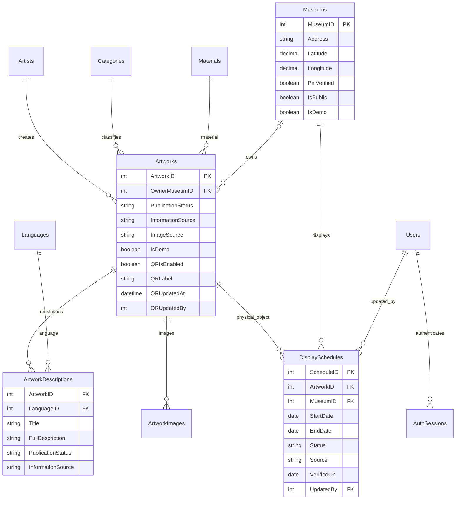

# Mô hình triển khai PRD

Đây là mô hình lõi dữ liệu; phạm vi sản phẩm và các giới hạn hiện tại ở [PRD](PRD.md).

Bản ERD vẽ lại có khóa, kiểu dữ liệu và các nhóm tài khoản/thống kê/giá vé nằm trong [bộ sơ đồ](diagrams/README.md). Ba hình ERD được chèn trực tiếp tại [mục 8 của PRD](PRD.md#8-dữ-liệu-và-tích-hợp); mô hình Mermaid dưới đây là bản tóm tắt.

Các bảng cũ giữ nguyên tên/khóa để không cắt đứt ảnh, QR và thống kê. `Catalog.sql` thêm trạng thái và các quan hệ mới; không thay DB bằng một sơ đồ mới.



`ArtworkDescriptions` giữ UNIQUE(ArtworkID,LanguageID). Một hiện vật có thể có nhiều lịch ở các bảo tàng qua thời gian; **không** suy ra vị trí hiện tại từ OwnerMuseumID.

```mermaid
sequenceDiagram
    participant Guest as Khách
    participant Web as Website
    participant API as Express API
    participant DB as SQL Server
    participant Router as OSRM
    Guest->>Web: Tìm + lọc + chọn ngôn ngữ
    Web->>API: GET catalog/artworks (query có phân trang)
    API->>DB: Published + vi Published + bộ lọc + lịch hiện tại
    DB-->>API: Bản dịch duyệt hoặc vi; bảo tàng từ Confirmed
    API-->>Web: requestedLanguage, contentLanguage, isFallback, currentExhibition
    Guest->>Web: Nhấn nghe
    Web->>Web: Chọn voice khớp contentLanguage hoặc báo chưa hỗ trợ
    Guest->>Web: Nhấn Dùng vị trí của tôi
    Web->>Guest: Xin quyền lấy vị trí
    Guest-->>Web: Cho phép, lấy tọa độ thành công
    Guest->>Web: Nhấn chỉ đường
    Web->>Router: Yêu cầu tuyến với điểm đi và điểm đến
    Router-->>Web: Hình học tuyến đường
    Web-->>Guest: Vẽ tuyến trên map; giữ địa chỉ khi lỗi
```

Xác nhận/sửa lịch: SQL SERIALIZABLE → khóa hàng Artworks của đúng hiện vật → khóa bảo tàng → khóa phạm vi lịch → kiểm tra `[start,end)` với end=null là vô hạn → lưu cùng nguồn/ngày kiểm chứng/UserID → commit. API cập nhật lịch và ẩn bảo tàng cùng khóa dữ liệu liên quan; lỗi/deadlock rollback, client giữ form để thử lại. Mọi API quản trị dùng cùng identity từ cookie session, không nhận role/UserID từ client.

Nhập bản dịch nháp không làm thay đổi ngôn ngữ công khai. TTS chỉ sử dụng ngôn ngữ thực của nội dung; không gọi dịch vụ dịch tự động để tự công bố nội dung chưa duyệt.

Cấu hình QR lưu trên Artworks; chỉ QR bật và nội dung công khai hợp lệ mới mở được luồng `source=qr`. Tắt QR không thay đổi PublicationStatus của tác phẩm. Tọa độ khách không lưu trong DB; chỉ giữ ở bộ nhớ và gửi tới dịch vụ định tuyến khi được yêu cầu.
