# PRD — Hệ thống tra cứu tác phẩm nghệ thuật MUSES

| Thông tin          | Nội dung                                                                          |
| ------------------ | --------------------------------------------------------------------------------- |
| Đề tài             | Xây dựng hệ thống tra cứu tác phẩm nghệ thuật Muses                               |
| Nhóm               | CNPM_GROUP6                                                                       |
| Ngày cập nhật      | 30/10/2026, giờ Việt Nam                                                          |
| Phạm vi tài liệu   | Website khách, Admin Dashboard và backend của bản MVP hiện tại                    |
| Mã nguồn đối chiếu | `31e2715` trên nhánh `develop` — trước đợt cập nhật tài liệu này                  |
| Căn cứ             | [PRD gốc](PRD-2026-10-29.txt), mã nguồn và các điều chỉnh chức năng đã thống nhất |
| Tài liệu cài đặt   | [README](../../README.md)                                                         |

PRD này mô tả yêu cầu sản phẩm hiện hành và phân biệt phần đã có trong mã nguồn với phần còn cần dữ liệu hoặc nghiệm thu thực tế. PRD gốc được giữ nguyên để truy vết thay đổi. “Đã triển khai” không đồng nghĩa đã nghiệm thu trên SQL Server, điện thoại hoặc môi trường triển khai công khai.

[Bộ sơ đồ phân tích](diagrams/README.md) đã được vẽ lại theo phạm vi này, gồm **Use Case tổng quát, 22 Use Case chi tiết và 4 trang ERD (3 nhóm chính và phần đặt vé cũ)**. Hình được chèn ở mục 5, 8 và 13; mỗi nhóm có file draw.io chỉnh sửa được. Ba file người dùng cung cấp ban đầu được lưu riêng để đối chiếu.

## Truy cập bản demo bằng QR

<a href="http://192.168.31.88:5173/">
  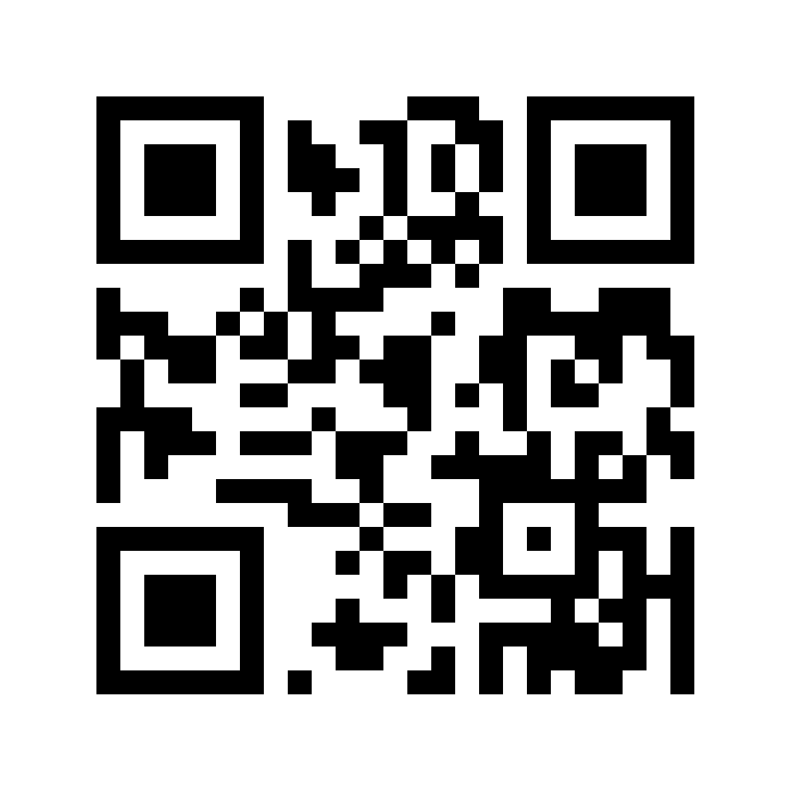
</a>

**Website:** <http://192.168.31.88:5173/> · [Tải QR PNG](assets/muses-website-qr.png) · [Tải QR SVG](assets/muses-website-qr.svg).

QR mở trang chủ của bản demo trong mạng Wi-Fi. Điện thoại và máy tính có IP `192.168.31.88` cần cùng mạng; website phải chạy ở cổng `5173`, backend chạy để tải dữ liệu. Xem [cách chạy trên mạng nội bộ](../../README.md#7-quét-qr-và-dùng-vị-trí-trên-điện-thoại). Khi đổi IP/cổng, cần tạo lại QR.

Trên website, **Quét QR → QR truy cập website** cũng hiển thị mã trang chủ, địa chỉ đích và nút tải PNG. Mã được tạo tại trình duyệt từ địa chỉ web đang mở; khi dùng localhost thì dùng địa chỉ demo ở trên, hoặc địa chỉ được cấu hình bằng `VITE_VISITOR_BASE_URL`. Mã trang chủ hoạt động độc lập với danh sách QR tác phẩm và không cộng lượt mở QR tác phẩm.

## 1. Tổng quan sản phẩm

Muses tập hợp thông tin tác phẩm nghệ thuật và nơi trưng bày để khách có thể tra cứu trước hoặc trong chuyến tham quan. Khách tìm tác phẩm theo tên/tác giả, đọc nội dung bằng ngôn ngữ phù hợp, nghe thuyết minh, mở QR, xem bảo tàng hiện đang trưng bày và xây dựng lộ trình tham quan tại TP.HCM.

Quản trị viên quản lý thông tin tác phẩm, bản dịch, dữ liệu bảo tàng, lịch trưng bày và trạng thái QR. Hệ thống ghi nhận hoạt động website để hỗ trợ theo dõi truy cập theo ngày/giờ và mức sử dụng QR/thuyết minh.

Thông tin bảo tàng sở hữu tác phẩm và bảo tàng đang trưng bày là hai khái niệm riêng. Muses chỉ xác nhận nơi trưng bày hiện tại khi có lịch hợp lệ trong dữ liệu quản trị.

## 2. Vấn đề và mục tiêu

### 2.1. Vấn đề cần giải quyết

- Thông tin tác phẩm, tác giả và nơi trưng bày thường phân tán; khách khó tìm đúng nội dung cần xem.
- Một tác phẩm/hiện vật có thể thay đổi nơi trưng bày qua thời gian; địa điểm sở hữu không đủ để xác định nơi khách có thể đến xem.
- Khách cần nội dung dễ đọc, nghe và lựa chọn ngôn ngữ trên điện thoại.
- Quản trị viên cần công bố dữ liệu và kiểm soát QR tại cùng một hệ thống, đồng thời hiểu cách khách sử dụng website.

### 2.2. Mục tiêu sản phẩm

1. Cung cấp luồng tìm kiếm → chi tiết → thuyết minh → nơi trưng bày liên tục, không bắt buộc tài khoản khách.
2. Dùng một nguồn dữ liệu có quản lý trạng thái công bố cho thông tin tác phẩm và bản dịch.
3. Hỗ trợ khám phá bảo tàng và lập kế hoạch tham quan với bản đồ, địa chỉ và lộ trình gợi ý.
4. Cho phép Admin quản lý các QR thực sự dùng trên web, bao gồm ngừng hoạt động mà vẫn giữ thông tin tác phẩm.
5. Theo dõi phiên/thiết bị truy cập, lượt mở QR và nghe thuyết minh theo khoảng thời gian, với định nghĩa chỉ số rõ ràng.

Đánh giá thành công dựa trên hoàn thành các luồng nghiệm thu ở mục 10; chưa có số liệu nghiên cứu người dùng, tỷ lệ chuyển đổi hoặc lượng khách thực tế để công bố như kết quả của đồ án.

## 3. Người dùng và quyền hạn

| Nhóm               | Nhu cầu                                                               | Quyền                                                            |
| ------------------ | --------------------------------------------------------------------- | ---------------------------------------------------------------- |
| Khách truy cập     | Tìm và tìm hiểu tác phẩm, nghe, quét QR, xem bảo tàng/lộ trình/giá vé | Truy cập nội dung công khai, không cần đăng nhập                 |
| Khách có tài khoản | Sử dụng tài khoản cá nhân tùy chọn                                    | Đăng ký/đăng nhập/đăng xuất; không có quyền quản trị             |
| Quản trị viên      | Cập nhật nội dung và theo dõi hoạt động website                       | Truy cập Admin và API quản trị bằng role `Admin`/`Administrator` |

Tài khoản SQL quản trị dùng cho setup/backup không phải một role người dùng trong website. Email/mật khẩu web Admin được tạo riêng, không dùng SQL login để đăng nhập giao diện.

## 4. Phạm vi MVP

### 4.1. Các phần đã có trong mã nguồn

| Nhóm                | Phạm vi                                                                                       |
| ------------------- | --------------------------------------------------------------------------------------------- |
| Tra cứu             | Bộ sưu tập, tìm/lọc kết hợp, phân trang, chi tiết và tác phẩm liên quan                       |
| Nội dung            | Năm ngôn ngữ, bản dịch công bố hoặc tiếng Việt dự phòng, audio URL và TTS theo văn bản        |
| QR                  | Danh sách QR hoạt động, popup, đọc mã bằng camera/ảnh/nội dung; kiểm tra trạng thái khi mở    |
| Bảo tàng            | Tìm địa điểm, bản đồ, vị trí khách theo yêu cầu, chỉ đường và lịch trưng bày hiện tại         |
| Lộ trình            | Chọn và sắp xếp 4 bảo tàng tham khảo, giờ bắt đầu/thời lượng, sơ đồ thứ tự/chủ đề             |
| Thông tin tham quan | Home, Visit, trang thông báo/bài viết, giao diện triển lãm/sự kiện, tra cứu giá vé            |
| Quản trị            | Tác phẩm, bản dịch/audio, tác giả/chất liệu/thể loại, bảo tàng, lịch, QR, Overview và Reports |
| Theo dõi truy cập   | Mã khách ẩn danh, phiên, lượt xem, mở QR, bắt đầu nghe và báo cáo theo ngày/giờ               |

### 4.2. Phần có giao diện nhưng còn giới hạn dữ liệu/phạm vi

- Tin tức và giao diện triển lãm/sự kiện hiện sử dụng nội dung cấu hình trong mã nguồn; ảnh có thể được lấy theo slot. Chưa có CMS tin tức/sự kiện đầy đủ trong Admin.
- Nội dung sự kiện minh họa không được xem là lịch triển lãm thực tế. Lịch hiện vật trong Admin phục vụ xác định nơi trưng bày là luồng dữ liệu riêng.
- Khung xem sơ đồ mặt bằng đã có, nhưng chưa gắn file sơ đồ thật cho 4 bảo tàng. Sơ đồ chủ đề chỉ gợi ý thứ tự xem, không thể hiện vị trí phòng/tầng.
- UI có phần lịch sử tác phẩm, nhưng nội dung lịch sử riêng chưa được nối đầy đủ vào API chi tiết; thiếu dữ liệu thì hiển thị trạng thái cập nhật.
- Giá vé phụ thuộc dữ liệu đã lưu; chưa có xác nhận tự động rằng giá đang đúng tại quầy. Mục chỉnh giá vé trong Admin đã được bỏ.
- Mobile Expo là phần phát triển riêng, chưa được xem là bản hoàn chỉnh tương đương các luồng web/API trong tài liệu này.

### 4.3. Ngoài phạm vi hiện tại

- Bán vé, thanh toán online, xác nhận chuyển khoản và xuất vé điện tử trong luồng khách hiện hành.
- Dịch máy tự động hoặc tự công bố bản dịch chưa duyệt; dịch vụ Docker LibreTranslate cũ không phải luồng đang sử dụng.
- Chuyển giọng nói thành văn bản, sinh/lưu MP3 bằng dịch vụ TTS backend hoặc căn chỉnh theo từ cho audio thu sẵn.
- Định vị người dùng trong nhà, định tuyến chính xác từng phòng và tối ưu lịch trình theo giao thông/giờ mở cửa thời gian thực.
- Đếm số người thực tế hiện diện tại bảo tàng hoặc xác nhận check-in vật lý chỉ từ QR/GPS.
- Menu Visitors riêng, quản lý giá vé trong Admin, nút Báo cáo theo ngày và chức năng xuất CSV trong giao diện hiện tại.
- Upload ảnh/audio lên server qua giao diện quản trị; hiện nhập URL và sử dụng tài nguyên đã có.

## 5. Luồng sử dụng chính

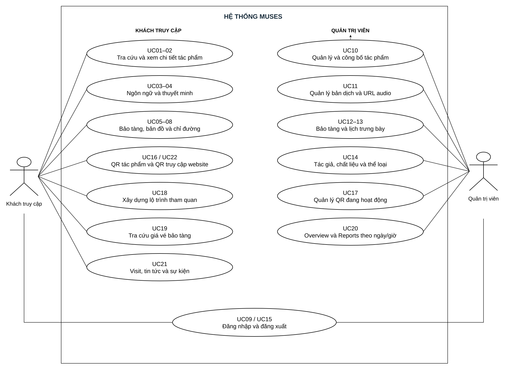

[Mở SVG để phóng to](diagrams/images/usecase-tong-quat.svg) · [File draw.io](diagrams/source/Muses_UseCase_TongQuat.drawio).

Mã **UC01–UC22** dùng cho các sơ đồ chi tiết ở mục 13. Sáu luồng dưới đây tổng hợp nhiều Use Case thành hành trình sử dụng; không phải bộ mã Use Case riêng. Khách không bắt buộc đăng nhập để tra cứu; mọi chức năng quản trị yêu cầu phiên và role hợp lệ.

### Luồng 01. Tìm hiểu một tác phẩm

Khách mở bộ sưu tập → nhập tên/chọn bộ lọc → chọn tác phẩm → xem thông tin → chọn ngôn ngữ → nghe thuyết minh hoặc xem nơi trưng bày. Không tìm được kết quả thì nhận thông báo danh sách rỗng; lỗi API có trạng thái thử lại.

### Luồng 02. Công bố tác phẩm

Admin đăng nhập → mở Artworks → nhập thông tin, ảnh và nội dung tiếng Việt trong cùng form → lưu nháp hoặc lưu và công bố. Nếu dữ liệu chưa đủ, hệ thống giữ form và thông báo để sửa. Bản dịch ngôn ngữ khác được quản lý trong Languages & Audio.

### Luồng 03. Sử dụng và quản lý QR

Khách mở `/scan` → chọn tác phẩm có QR hoạt động → xem/tải mã → quét để mở chi tiết. Admin mở Quản lý QR → tìm tác phẩm → đổi tên hoặc bật/tắt mã. Mã đã tắt bị chặn ở lần mở/tạo tiếp theo; nội dung công khai trong bộ sưu tập vẫn được giữ.

### Luồng 04. Tìm bảo tàng và chỉ đường

Khách tìm địa điểm → chọn ghim/thẻ bảo tàng → xem tên/địa chỉ. Khi muốn vẽ đường đi trên map Muses, khách bấm Dùng vị trí của tôi và cho phép lấy vị trí → chọn Chỉ đường. Khi chưa lấy vị trí thành công, nút chỉ đường trên map bị khóa; khách vẫn tìm/xem địa điểm được.

### Luồng 05. Lập kế hoạch tham quan

Khách mở `/museums/itinerary` → chọn bảo tàng → thay thứ tự, giờ bắt đầu và thời lượng → xem sơ đồ thứ tự/chủ đề. Nếu có vị trí, có thể sắp xếp điểm gần nhất trước hoặc chỉ đường tới một điểm. Kế hoạch không tự xác nhận giờ mở cửa hay đặt vé.

### Luồng 06. Xem báo cáo truy cập

Admin mở Overview hoặc Reports → chọn khoảng ngày và khung giờ → xem dữ liệu tương ứng. Overview có danh sách phiên để tìm/lọc trạng thái. Reports hiển thị chi tiết theo ngày, giờ, điểm đọc. Hôm nay/7 ngày có trạng thái chọn màu đen; Cả ngày đặt khung giờ về 00:00–24:00.

## 6. Yêu cầu chức năng

`P0`: chức năng cốt lõi để nghiệm thu luồng tra cứu/quản trị. `P1`: chức năng hỗ trợ trải nghiệm hoặc nội dung bổ sung. Mức ưu tiên không thay thế trạng thái triển khai/giới hạn ở mục 4.

### 6.1. Website khách

| Mã     | Ưu tiên | Chức năng và yêu cầu                                                                                             | Tiêu chí chấp nhận                                                                                         |
| ------ | ------- | ---------------------------------------------------------------------------------------------------------------- | ---------------------------------------------------------------------------------------------------------- |
| WEB-01 | P1      | Home hiển thị Highlight từ tác phẩm công khai; thẻ được chọn mở rộng/hiện thông tin, điều hướng vòng lặp         | Không đưa bản nháp vào Highlight; dùng được mũi tên, bàn phím và thao tác trên điện thoại                  |
| WEB-02 | P0      | Tìm theo tên tác phẩm/tác giả, kết hợp lọc tác giả/chất liệu/bảo tàng hiện tại; phân trang 12                    | API và tổng kết quả cùng áp dụng bộ lọc; không có kết quả thì báo rỗng                                     |
| WEB-03 | P0      | Chi tiết hiển thị dữ liệu theo ID: ảnh, tên, tác giả, năm, chất liệu, kích thước, mô tả và tác phẩm cùng nghệ sĩ | Truy cập trực tiếp tác phẩm chưa công bố không trả nội dung công khai; ảnh lỗi có trạng thái thay thế      |
| WEB-04 | P0      | Cho chọn `vi/en/zh/ja/ko`; chỉ dùng bản dịch Published có nội dung đầy đủ                                        | Thiếu bản dịch thì trả tiếng Việt cùng metadata ngôn ngữ thực; không trộn tiêu đề/mô tả từ bản nháp        |
| WEB-05 | P0      | Đọc văn bản thành tiếng, tạm dừng/tiếp tục/dừng, chọn giọng/tốc độ và theo dõi phần đang đọc                     | Giọng khớp ngôn ngữ văn bản; thiếu giọng có thông báo; đổi tác phẩm/nội dung thì dừng bản đọc cũ           |
| WEB-06 | P1      | Phát audio thu sẵn khi có URL                                                                                    | Không phát chồng với TTS; không hứa tô sáng theo từ cho bản thu thiếu timestamp                            |
| WEB-07 | P0      | `/scan` hiển thị tác phẩm có QR hoạt động; popup có ảnh QR, tải ảnh và liên kết chi tiết                         | QR dẫn đúng tác phẩm/ngôn ngữ; mã đã tắt không xuất hiện trong danh sách và không sinh popup QR mới        |
| WEB-08 | P0      | Bộ đọc QR hỗ trợ camera, ảnh và nội dung dán                                                                     | Chỉ nhận dạng mã tác phẩm hợp lệ, không tự điều hướng sang host lạ; lỗi/camera bị từ chối có cách tiếp tục |
| WEB-09 | P0      | Chi tiết xác định bảo tàng trưng bày hiện tại từ lịch hợp lệ và hiển thị bản đồ/địa chỉ                          | Không thay thế bằng bảo tàng sở hữu; không có lịch thì báo chưa có xác nhận                                |
| WEB-10 | P0      | Tìm bảo tàng/không gian nghệ thuật theo tên/địa chỉ tại TP.HCM; xem ghim và chi tiết                             | Có danh sách tham khảo khi nguồn ngoài lỗi; ghim tham khảo được phân biệt với tọa độ đã xác minh           |
| WEB-11 | P0      | Lấy vị trí khi khách chủ động bấm nút; chỉ vẽ tuyến sau khi có vị trí                                            | Trước khi bấm nút không xin GPS; từ chối vẫn tra cứu được; reset vị trí xóa tuyến và hủy yêu cầu chờ       |
| WEB-12 | P1      | Lập lộ trình trong 4 bảo tàng, thay thứ tự/giờ bắt đầu/thời lượng                                                | Sơ đồ và tổng thời gian đổi theo lựa chọn; không ghi giả thời gian di chuyển hoặc vị trí phòng/tầng        |
| WEB-13 | P1      | Visit cung cấp các mục thông tin tham quan, điểm đến/ngày và liên kết bản đồ/giá vé                              | Điều hướng đúng mục/trang; không khẳng định tiện ích hoặc giờ mở cửa chưa có dữ liệu xác minh              |
| WEB-14 | P1      | Tin tức có danh sách và bài viết; sự kiện có bộ lọc ngày/thể loại                                                | Link mở đúng bài; dữ liệu minh họa được phân biệt; không gọi đây là CMS hoàn chỉnh                         |
| WEB-15 | P1      | Tra cứu giá vé theo tên/địa chỉ bảo tàng và đối tượng; sắp xếp giá                                               | `0` là miễn phí; thiếu giá hiện Chưa cập nhật; không phát sinh đơn mua vé/thanh toán                       |
| WEB-16 | P1      | Cho phép đăng ký/đăng nhập/đăng xuất khách tùy chọn                                                              | Không bắt buộc đăng nhập ở các luồng tra cứu; client không tự chọn được role quản trị                      |
| WEB-17 | P1 | Hiển thị QR truy cập trang chủ tại /scan, tải PNG và mở trang chủ | QR dùng địa chỉ HTTP(S) truy cập được từ thiết bị khách; không tính thành lượt quét QR tác phẩm |

### 6.2. Admin Dashboard

| Mã     | Ưu tiên | Chức năng và yêu cầu                                                                         | Tiêu chí chấp nhận                                                                                                  |
| ------ | ------- | -------------------------------------------------------------------------------------------- | ------------------------------------------------------------------------------------------------------------------- |
| ADM-01 | P0      | Xác thực và phân quyền cho giao diện lẫn API quản trị                                        | Không có phiên trả 401; role không hợp lệ trả 403; đăng xuất vô hiệu phiên cũ                                       |
| ADM-02 | P0      | Nhập metadata, ảnh và mô tả tiếng Việt của tác phẩm trong một form; lưu nháp/công bố/ẩn      | Lưu và công bố không bắt chuyển trang bản dịch; lưu lỗi không làm công bố dữ liệu dở dang                           |
| ADM-03 | P0      | Quản lý bản dịch/URL audio, trạng thái và nghe thử                                           | Mỗi tác phẩm/ngôn ngữ có tối đa một bản mô tả; bản nháp không ảnh hưởng nội dung công khai                          |
| ADM-04 | P0      | Quản lý tác giả, chất liệu, thể loại                                                         | Không xóa mục đang được tác phẩm tham chiếu; lỗi quan hệ có thông báo                                               |
| ADM-05 | P0      | Quản lý bảo tàng, địa chỉ, tọa độ, nguồn và trạng thái công khai                             | Tọa độ hợp lệ; bảo tàng công khai cần dữ liệu và xác minh ghim theo quy tắc API                                     |
| ADM-06 | P0      | Quản lý lịch hiện vật tại bảo tàng với Draft/Confirmed/Cancelled                             | Kiểm tra ngày/nguồn/ngày xác minh; ngăn lịch Confirmed chồng nhau cho cùng hiện vật                                 |
| ADM-07 | P0      | Quản lý QR lấy từ dữ liệu tác phẩm: tìm/lọc, đổi tên, bật/tắt, xem/tải PNG và thống kê mở    | Trạng thái lưu DB; không bật QR cho nội dung chưa công khai; không xóa lịch sử lượt mở khi tắt mã                   |
| ADM-08 | P0      | Overview gộp số liệu tổng quan với danh sách phiên khách, tìm tên/mã phiên và lọc trạng thái | Không còn menu Visitors riêng; danh sách ghi rõ tối đa 100 phiên mới nhất trong kỳ                                  |
| ADM-09 | P0      | Reports lọc khoảng ngày và khung giờ Việt Nam, thống kê ngày/giờ/điểm đọc                    | Các số liệu lịch sử dùng cùng bộ lọc; không còn chuỗi liệt kê giờ cao điểm dài, nút Báo cáo theo ngày hoặc Xuất CSV |

## 7. Quy tắc nghiệp vụ và dữ liệu

### BR-01. Công bố nội dung

- Tác phẩm có các trạng thái Draft, Published, Hidden. Nội dung công khai cần tác phẩm Published và bản tiếng Việt Published có tên/mô tả đầy đủ.
- Khi công bố qua form Artworks, yêu cầu ảnh và các dữ liệu bắt buộc theo API. Nguồn thông tin, nguồn bản dịch và nguồn/quyền ảnh là trường tùy chọn trong form hiện hành.
- Nhập tiếng Việt cùng tác phẩm được lưu trong một giao dịch; lỗi phải rollback phần thay đổi liên quan. Bản dịch ngôn ngữ khác không bị ghi đè bởi thao tác này.
- Tác phẩm/hiện vật được xác định bằng ID. Các bản sao cần quản lý riêng không được suy ra là cùng hiện vật chỉ vì trùng tên.

### BR-02. Bản dịch và thuyết minh

- Một cặp tác phẩm/ngôn ngữ chỉ có một bản mô tả. Chỉ dùng bản đã công bố và đủ nội dung.
- Thiếu bản dịch mục tiêu thì dùng toàn bộ nội dung tiếng Việt tương ứng, kèm ngôn ngữ thực/fallback.
- TTS chọn giọng theo nội dung thực tế. Khi đang hiển thị bản gốc do thiếu bản dịch, người dùng có thể đọc bản gốc nếu có giọng phù hợp.
- Tô sáng câu/từ phụ thuộc các sự kiện mà speech engine cung cấp. Tính năng hiện tại không sinh file audio mới và không bảo đảm mọi giọng đều hỗ trợ ranh giới từ.

### BR-03. Bảo tàng đang trưng bày

- Lịch hiện tại phải Confirmed, bảo tàng công khai và thỏa `startDate <= ngày Việt Nam < endDate`; `endDate` trống nghĩa là chưa có ngày kết thúc.
- Ngày kết thúc loại trừ; lịch tương lai/đã hủy/hết hạn không phải nơi trưng bày hiện tại.
- Không suy diễn vị trí từ bảo tàng sở hữu hoặc ghim tham khảo trên bản đồ.
- Không cho các lịch Confirmed của cùng một hiện vật chồng nhau. Không ẩn bảo tàng còn lịch hiện tại/tương lai đã xác nhận.

### BR-04. Vị trí và lộ trình

- Khách phải bấm Dùng vị trí của tôi; chỉ khi lấy tọa độ thành công mới bật chỉ đường trên map Muses.
- Vị trí giữ trong bộ nhớ trình duyệt; reset hoặc reload làm mất vị trí. Không ghi tọa độ khách vào DB/API thống kê Muses.
- Khi yêu cầu tuyến đường, trình duyệt gửi điểm đi/đến cho OSRM. Các liên kết ngoài như Google Maps do khách chủ động mở.
- Bốn địa điểm tham khảo: Bảo tàng Mỹ thuật TP.HCM, Bảo tàng Chứng tích Chiến tranh, Bảo tàng Lịch sử TP.HCM và Bảo tàng TP.HCM. Ghim tham khảo là tọa độ xấp xỉ.
- Sắp xếp gần nhất là gợi ý theo khoảng cách; chưa phải lời giải tối ưu đường bộ. Thời gian kế hoạch chỉ cộng thời lượng tham quan, chưa tính di chuyển/xếp hàng/nghỉ.

### BR-05. QR

- Mỗi tác phẩm có một nhóm QR gốc. Các biến thể ngôn ngữ/điểm đọc dùng chung trạng thái bật/tắt.
- QR hoạt động khi cấu hình được bật và tác phẩm có nội dung công khai hợp lệ. Tác phẩm mới đủ điều kiện được đưa vào danh sách theo cấu hình mặc định của DB.
- Tắt mã có hiệu lực ở lần mở/tạo/reload tiếp theo; không xóa ảnh QR đã tải hoặc nội dung đang mở trên thiết bị khác.
- Luồng QR công khai kiểm tra trạng thái trước khi mở chi tiết. Lỗi kiểm tra không được tự bỏ qua để hiện chi tiết.
- Tắt QR không thay thế quyền truy cập tác phẩm: tác phẩm còn Published vẫn xem được qua luồng bộ sưu tập thông thường.
- Lượt mở QR là lần mở liên kết QR được xác nhận hợp lệ, không chứng minh có camera quét tại bảo tàng. Xem/tải PNG không cộng lượt mở; reload tức thời được chống đếm lặp trong 10 giây.

### BR-06. Chỉ số truy cập

| Chỉ số            | Định nghĩa                                                                                                                               |
| ----------------- | ---------------------------------------------------------------------------------------------------------------------------------------- |
| Khách/thiết bị    | Mã ẩn danh lưu ở trình duyệt, không phải định danh một người thực tế                                                                     |
| Phiên             | Mã phiên trong sessionStorage; sau 30 phút không ghi nhận tín hiệu, lần hoạt động tiếp theo tạo phiên mới; các tab có thể có phiên riêng |
| Đang hoạt động    | Có tín hiệu website trong 5 phút gần nhất; tab đang hiển thị gửi heartbeat định kỳ mỗi phút                                              |
| Tên khách         | Hiển thị khi có tài khoản khách đăng nhập; khách không đăng nhập được gắn nhãn ẩn danh                                                   |
| Lượt mở QR        | Sự kiện mở qua liên kết QR hợp lệ                                                                                                        |
| Lượt bắt đầu nghe | Sự kiện bắt đầu phát thuyết minh được ghi nhận; không đếm thao tác tạm dừng/tiếp tục như lần bắt đầu mới                                 |
| Tham gia điểm đọc | Thiết bị mở QR hoặc bắt đầu nghe tại mã điểm; không phải xác nhận hiện diện vật lý                                                       |

Một người dùng nhiều trình duyệt/thiết bị có thể được tính nhiều mã khách; nhiều người dùng chung một trình duyệt có thể chỉ có một mã khách. Mở trang, heartbeat, QR và nghe là các tín hiệu hệ thống, không xác nhận khách thực sự đọc hết nội dung.

### BR-07. Khung giờ báo cáo

- Khoảng ngày tối đa 366 ngày; thời gian lưu UTC và hiển thị/lọc theo Việt Nam (UTC+7).
- Chọn giờ nguyên: từ 00:00–23:00, đến 01:00–24:00; giờ kết thúc phải lớn hơn giờ bắt đầu. Đầu khoảng bao gồm, cuối khoảng loại trừ.
- Khung giờ áp dụng trong **mỗi ngày** của khoảng ngày đã chọn. Chưa hỗ trợ một khoảng đảo qua nửa đêm; Cả ngày là `[00:00,24:00)`.
- Tổng phiên/thiết bị, lượt QR/nghe và bảng lịch sử dùng cùng bộ lọc. Với khoảng giờ hẹp, phiên phải có sự kiện trong khoảng đó; thời gian hoạt động cuối vẫn là giá trị mới nhất của phiên.
- Chỉ số Khách đang hoạt động luôn là 5 phút gần nhất ở thời điểm xem, độc lập với khoảng ngày/giờ lịch sử.

### BR-08. Giá vé và dữ liệu tham khảo

- Giá đúng bằng `0` biểu thị miễn phí; giá thiếu/không công khai/không hợp lệ biểu thị Chưa cập nhật.
- Giá công khai từ DB chỉ áp dụng cho bảo tàng công khai, không phải bản ghi demo và có cấu hình giá hoạt động. Danh sách 4 bảo tàng tham khảo vẫn có thể hiển thị khi chưa có giá.
- Ngày chọn để lập kế hoạch không tạo đặt chỗ, không xác nhận giờ mở cửa hoặc giá vé lịch sử.

## 8. Dữ liệu và tích hợp

| Nhóm dữ liệu      | Thành phần chính                                              | Trách nhiệm                                                               |
| ----------------- | ------------------------------------------------------------- | ------------------------------------------------------------------------- |
| Catalogue         | Artworks, Artists, Categories, Materials                      | Tác phẩm và các danh mục tham chiếu                                       |
| Nội dung ngôn ngữ | ArtworkDescriptions, Languages                                | Tiêu đề/mô tả, trạng thái và URL audio theo ngôn ngữ                      |
| Hình ảnh          | ArtworkImages, SiteImages                                     | Ảnh tác phẩm và vị trí ảnh theo slot; URL trỏ tới tài nguyên được phục vụ |
| Địa điểm/lịch     | Museums, DisplaySchedules                                     | Bảo tàng sở hữu/trưng bày, địa chỉ/tọa độ và lịch theo thời gian          |
| QR                | QRIsEnabled, QRLabel, QRUpdatedAt, QRUpdatedBy trong Artworks | Cấu hình nhóm QR và ghi nhận thay đổi                                     |
| Xác thực          | Users, AuthSessions                                           | Tài khoản, vai trò và phiên đăng nhập                                     |
| Theo dõi          | AnalyticsSessions, AnalyticsEvents, AuthLoginEvents           | Phiên và sự kiện truy cập                                                 |
| Giá vé            | TicketOffers                                                  | Giá và điều kiện đã lưu để khách tra cứu                                  |
| Nội dung biên tập | Các file dữ liệu News/Exhibition và tài nguyên frontend       | Nội dung thông báo/sự kiện chưa có CMS đầy đủ                             |

Các bảng/route đặt vé cũ có thể còn để tương thích mã nguồn; không tính thành chức năng mua vé hiện hành. Các dịch vụ bản đồ ngoài là nguồn phụ thuộc, không phải dữ liệu do Muses tự xác minh. TTS do trình duyệt và giọng được cung cấp trên thiết bị thực hiện.

### 8.1. ERD tác phẩm, ngôn ngữ và hình ảnh

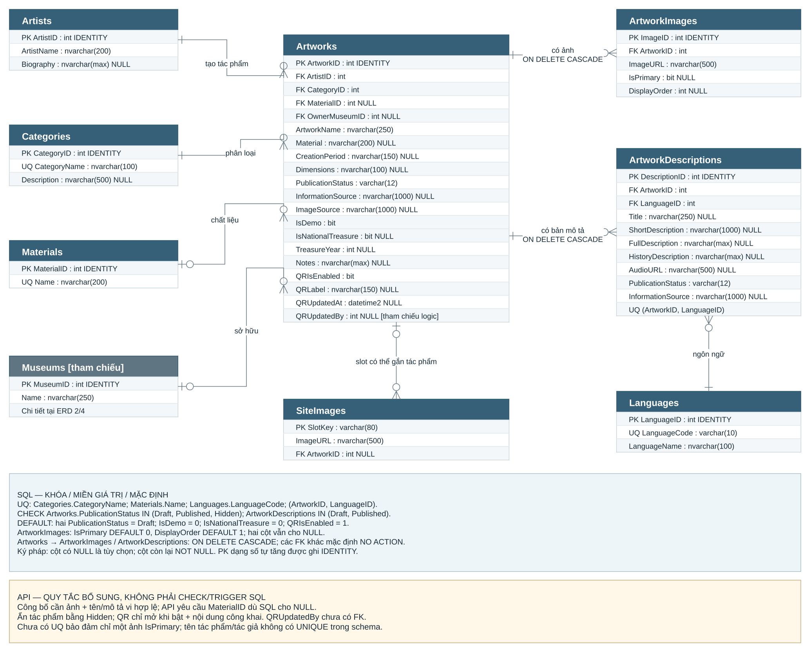

[Mở SVG](diagrams/images/erd-catalogue.svg) · [File ERD draw.io — 4 trang](diagrams/source/Muses_ERD.drawio).

### 8.2. ERD bảo tàng, lịch trưng bày và giá vé

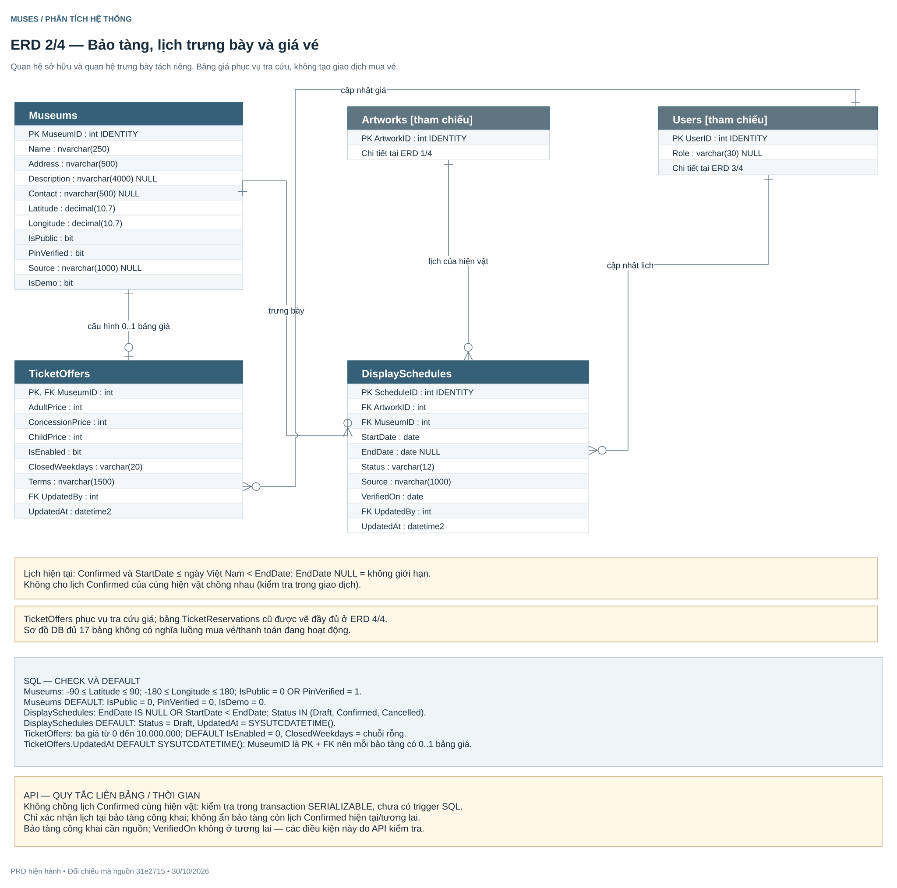

[Mở SVG](diagrams/images/erd-museums.svg).

### 8.3. ERD tài khoản, phiên và sự kiện website

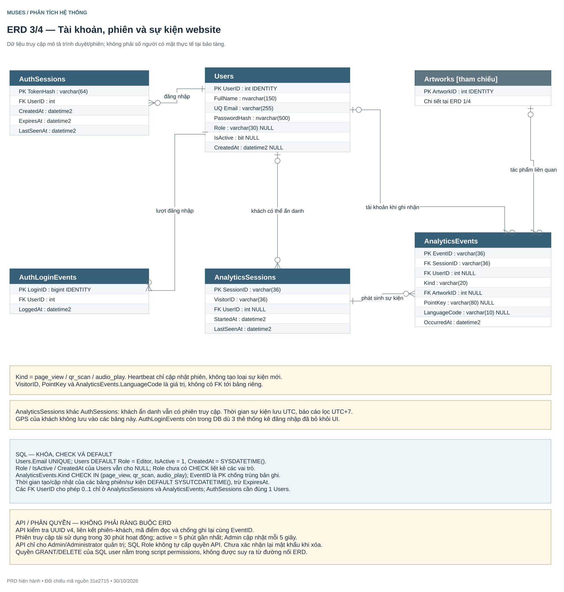

[Mở SVG](diagrams/images/erd-activity.svg).

### 8.4. ERD phần đặt vé cũ (tương thích)

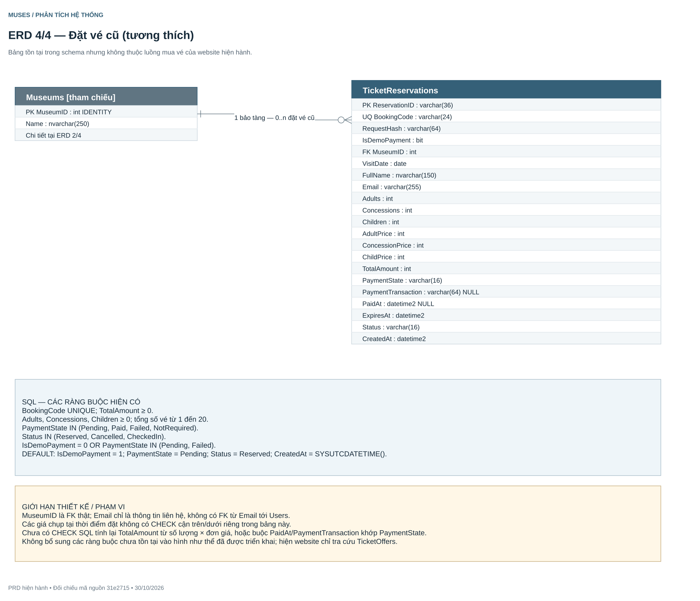

[Mở SVG](diagrams/images/erd-legacy-tickets.svg). Bảng còn trong schema nhưng không thuộc luồng mua vé hiện hành; Ticket hiện dùng để tra cứu giá vé.

ERD dùng tên bảng thực tế: `Users`, `ArtworkDescriptions`, `DisplaySchedules` và `Languages.LanguageID`. Nhãn **tham chiếu** là cùng bảng được lặp lại ở nhóm khác để đọc quan hệ, không phải bảng mới. `PK` là khóa chính, `FK` là khóa ngoại, `UQ` là ràng buộc duy nhất; chân quạ biểu thị nhiều và vòng tròn biểu thị có thể không có quan hệ.

Cấu hình QR nằm trên `Artworks`; `QRUpdatedBy` được code ghi bằng UserID nhưng migration hiện tại chưa tạo FK, nên được ghi rõ là tham chiếu logic. Không thêm bảng `AdminUsers`, `MuseumTranslations` hoặc bảng QR giả vào mô hình hiện hành. `TicketReservations` được đưa vào trang tương thích để đủ **17 bảng, 20 FK, 6 UNIQUE và 15 biểu thức CHECK** của schema. Tọa độ khách không lưu trong DB này. Các khung xanh ghi CHECK/default và hành vi xóa của SQL; khung vàng ghi quy tắc backend và giới hạn chưa được SQL ràng buộc. Xem [báo cáo rà soát ràng buộc](diagrams/CONSTRAINT-REVIEW.md) để đối chiếu từng quan hệ. Hình không thay thế script migration.

## 9. Yêu cầu phi chức năng

| Mã     | Yêu cầu                                                                                                                 | Cách đánh giá                                                                                          |
| ------ | ----------------------------------------------------------------------------------------------------------------------- | ------------------------------------------------------------------------------------------------------ |
| NFR-01 | Responsive cho desktop/tablet/điện thoại; nội dung chính dùng được ở 375/768/1440 px                                    | Kiểm tra bố cục, bảng cuộn trong khung và thao tác thực tế                                             |
| NFR-02 | Có label, alt ảnh, điều hướng bàn phím, focus/modal và trạng thái loading/error/empty                                   | Duyệt các luồng chính bằng bàn phím và trình đọc màn hình phù hợp; không tự tuyên bố chứng nhận WCAG   |
| NFR-03 | TTS, camera, GPS hoặc nguồn bản đồ lỗi không làm mất toàn bộ nội dung tra cứu                                           | Thử từ chối quyền, ngắt nguồn API và dùng phương án thay thế/Thử lại                                   |
| NFR-04 | Phân quyền được kiểm tra ở server; mật khẩu băm scrypt, phiên cookie HttpOnly, query có tham số                         | Kiểm thử API 401/403, đăng xuất, dữ liệu đầu vào và cấu hình cookie/HTTPS khi triển khai               |
| NFR-05 | Không dùng SQL quản trị làm tài khoản runtime thường xuyên; không lộ mật khẩu trong frontend/Git                        | Rà cấu hình, phạm vi quyền và quy trình setup                                                          |
| NFR-06 | Không ghi GPS của khách vào DB analytics; số liệu mô tả đúng trình duyệt/phiên                                          | Kiểm tra payload và định nghĩa chỉ số; việc gửi tọa độ tới dịch vụ định tuyến chỉ sau thao tác yêu cầu |
| NFR-07 | Cập nhật DB có backup/kiểm tra backup, migration chạy lại được và giữ dữ liệu/cấu hình đã có                            | Chạy trên DB thử và kiểm tra phục hồi riêng; VERIFYONLY không thay thế restore thật                    |
| NFR-08 | Mục tiêu API tra cứu p95 ≤ 2 giây với 1.000 tác phẩm Published, 20 worker/200 request trên môi trường kiểm thử xác định | Dùng script test:load và lưu kết quả; chưa coi đây là hiệu năng đã đạt trên SQL thật                   |
| NFR-09 | Không hiển thị dữ liệu giả như dữ liệu bảo tàng đã xác minh; không làm sai số liệu khi thiếu nguồn                      | Kiểm tra nhãn demo/tham khảo, giá thiếu, lịch thiếu và báo lỗi thay vì tự bịa dữ liệu                  |

Thiết kế giao diện dùng tông kem/nâu/đen cho website và nền kem, sidebar đen, thẻ màu pastel cho Admin. Ảnh tác phẩm phủ khung và giữ tỉ lệ; icon/sơ đồ cần giữ đủ nội dung để đọc được.

## 10. Tiêu chí nghiệm thu

Các tiêu chí dưới đây là đầu việc kiểm chứng, không phải biên bản đánh dấu tất cả đã hoàn thành.

| Mã    | Tình huống kiểm tra                                                   | Kết quả mong đợi                                                                                                   |
| ----- | --------------------------------------------------------------------- | ------------------------------------------------------------------------------------------------------------------ |
| AT-01 | Tìm kiếm kết hợp tác giả/chất liệu/bảo tàng và chuyển trang           | Chỉ trả giao của các bộ lọc; tổng kết quả/phân trang đúng                                                          |
| AT-02 | Mở trực tiếp ID tác phẩm Draft/Hidden                                 | API công khai không trả nội dung tác phẩm đó                                                                       |
| AT-03 | Lưu tác phẩm và nội dung tiếng Việt rồi công bố tại một form          | Thành công ở một luồng; thiếu dữ liệu/lỗi DB giữ form và không công bố dở dang                                     |
| AT-04 | Chọn đủ 5 ngôn ngữ có bản dịch Published                              | Hiển thị đúng bản dịch và chọn giọng đúng ngôn ngữ nếu thiết bị có hỗ trợ                                          |
| AT-05 | Chọn ngôn ngữ thiếu bản dịch hoặc thiếu voice                         | Có fallback/thông báo; đọc bản gốc bằng giọng phù hợp khi có, không tự gán giọng sai                               |
| AT-06 | Đọc, tạm dừng, tiếp tục, đổi tác phẩm/ngôn ngữ                        | Điều khiển đúng; dừng nội dung cũ; kiểm tra riêng trên loa/giọng thật                                              |
| AT-07 | Mở popup QR, tải ảnh và giải mã bằng ảnh/camera                       | Mở đúng ID/ngôn ngữ; PNG preview không làm tăng lượt mở                                                            |
| AT-08 | Tắt QR, quét lại liên kết đã tạo; sau đó bật lại                      | Lần mở mới bị chặn khi tắt, hoạt động lại khi bật; bộ sưu tập thường vẫn xem tác phẩm Published                    |
| AT-09 | Lịch bắt đầu hôm nay, kết thúc hôm nay hoặc thuộc tương lai           | Xử lý đúng đầu bao gồm/cuối loại trừ; không suy từ bảo tàng sở hữu                                                 |
| AT-10 | Gửi hai lịch Confirmed chồng nhau cho cùng hiện vật                   | Chỉ một lịch hợp lệ được lưu; kiểm chứng cạnh tranh trên SQL Server thật                                           |
| AT-11 | Vào map nhưng chưa bấm Dùng vị trí của tôi                            | Không tự xin GPS và không vẽ chỉ đường                                                                             |
| AT-12 | Lấy vị trí thành công rồi chỉ đường/reset/từ chối lần sau             | Có tuyến khi đủ điều kiện; reset/từ chối xóa và khóa tuyến, vẫn tra cứu được                                       |
| AT-13 | Chọn/bỏ bảo tàng, đổi thứ tự/thời lượng trong planner                 | Danh sách, sơ đồ và tổng thời gian đổi tương ứng; không gọi sơ đồ chủ đề là mặt bằng                               |
| AT-14 | Mở tin tức, sự kiện và lọc ngày cụ thể                                | Link đúng, bộ lọc đúng dữ liệu cấu hình; nhãn minh họa phù hợp                                                     |
| AT-15 | Giá bằng 0, giá chưa có và API giá lỗi                                | Phân biệt miễn phí/Chưa cập nhật; không tạo giao dịch hoặc đơn đặt vé                                              |
| AT-16 | Không cookie, role Visitor hoặc cookie sau đăng xuất gọi API quản trị | Bị từ chối; không có thay đổi dữ liệu                                                                              |
| AT-17 | Khách mở web/QR/nghe rồi xem Overview                                 | Có tín hiệu đúng loại; số liệu không được diễn giải thành người có mặt tại bảo tàng                                |
| AT-18 | Chọn 09:00–17:00, 23:00–24:00 và Cả ngày                              | API nhận đúng khung giờ Việt Nam; số liệu lịch sử/biểu đồ khớp bộ lọc; số khách hoạt động vẫn theo 5 phút gần nhất |
| AT-19 | Mở lại link Admin Visitors/QR Check-in cũ                             | Mở Overview/Quản lý QR tương ứng; không còn menu Visitors, Giá vé hoặc nút CSV/Báo cáo theo ngày                   |
| AT-20 | Lỗi API, nguồn bản đồ, ảnh hoặc thiết bị chặn quyền                   | Có trạng thái lỗi và đường tiếp tục phù hợp, không thay bằng dữ liệu giả                                           |
| AT-21 | Quét QR trang chủ bằng điện thoại, tải PNG hoặc mở trang chủ | Mở đúng trang chủ bằng địa chỉ truy cập được; không ghi nhận nhầm thành lượt QR tác phẩm |

### Điều kiện trước khi nộp/triển khai

- Các luồng P0 được kiểm tra trên database đã migrate và dữ liệu công bố của nhóm.
- Kiểm tra QR trên điện thoại thật, camera/GPS qua HTTPS, TTS/giọng thật và các trình duyệt mục tiêu.
- Kiểm tra SQL migration chạy lại, quyền runtime, ràng buộc lịch đồng thời và backup/restore trên môi trường thử.
- Lưu biên bản: phiên bản code, môi trường, dữ liệu, người kiểm tra, thời điểm, kết quả và lỗi còn mở.
- Nếu đưa sơ đồ mặt bằng vào phạm vi nghiệm thu, cần gắn đúng file/sơ đồ của từng bảo tàng; không nghiệm thu phần này chỉ bằng sơ đồ chủ đề hiện có.

## 11. Rủi ro và phần việc tiếp theo

| Vấn đề                                               | Tác động                                                        | Hướng xử lý                                                                                            |
| ---------------------------------------------------- | --------------------------------------------------------------- | ------------------------------------------------------------------------------------------------------ |
| Dữ liệu tác phẩm/lịch/bản dịch chưa đủ hoặc còn nháp | Khách không thấy nội dung hay nơi trưng bày mong muốn           | Chuẩn bị dữ liệu nghiệm thu và công bố qua Admin                                                       |
| Giọng TTS, GPS/camera khác nhau theo thiết bị        | Luồng nghe/quét/định vị không đồng nhất                         | Kiểm tra thiết bị mục tiêu và duy trì thông báo/cách tiếp tục                                          |
| Overpass/OSM/OSRM lỗi hoặc bị giới hạn               | Thiếu địa điểm, nền map hoặc tuyến đường                        | Dùng danh sách tham khảo, địa chỉ, thử lại và liên kết ngoài; chọn dịch vụ phù hợp nếu triển khai rộng |
| QR dùng localhost/IP cũ hoặc chưa migrate cấu hình   | Điện thoại không mở được mã hoặc không kiểm tra trạng thái được | Dùng origin truy cập được, cập nhật DB/backend và thử mã thật                                          |
| Thiếu file sơ đồ mặt bằng/nội dung lịch sử           | Chưa đủ thông tin để hoàn thiện tham quan trong bảo tàng        | Bổ sung nguồn, file và tích hợp dữ liệu đúng nơi; giữ thông báo thiếu dữ liệu                          |
| Tin tức/sự kiện và mobile chưa có đầy đủ backend     | Chưa thể quản trị toàn bộ sản phẩm từ một nơi                   | Phát triển thành phạm vi tiếp theo, không tính như chức năng đã hoàn tất                               |

Hướng mở rộng: CMS tin tức/sự kiện, quản lý nguồn giá vé, sơ đồ phòng/tầng được xác minh, nội dung lịch sử đầy đủ, đồng bộ mobile với API và tối ưu triển khai/hiệu năng. Dịch tự động hoặc thanh toán chỉ đưa vào sau khi có yêu cầu và hạ tầng tích hợp phù hợp.

## 12. Truy vết và tài liệu kỹ thuật

- [README](../../README.md): cài đặt, vận hành, route và xử lý lỗi.
- [Bộ sơ đồ và file draw.io](diagrams/README.md), [mô hình kỹ thuật tóm tắt](MODEL.md).
- [PRD gốc ngày 29/10/2026](PRD-2026-10-29.txt): giữ nguyên nguồn yêu cầu ban đầu.
- [RUN](RUN.md): setup/backup và kiểm thử SQL.
- [ACCEPTANCE](ACCEPTANCE.md): đối chiếu lần triển khai PRD gốc; kết quả lịch sử không thay thế nghiệm thu bản hiện tại.
- [Quản lý QR](../QR-MANAGEMENT.md), [QR tác phẩm](../ARTWORK-QR.md).
- [Bản đồ/lộ trình](../MAPS.md), [Visit](../VISIT.md), [giá vé](../TICKETS.md).
- [Thống kê truy cập](../ADMIN-ANALYTICS.md), [Highlight](../HIGHLIGHT.md), [ảnh triển lãm](../EXHIBITION-IMAGES.md).

Bằng chứng tự động nằm trong `muses-backend/test`, `muses-react/tests` và `muses-react/tests/browser`. Kiểm thử adapter SQL/API giả xác nhận các quy tắc và luồng được kiểm soát; kiểm chứng SQL thật, dữ liệu thực tế, độ chính xác bản đồ, giọng đọc và camera/điện thoại cần biên bản riêng.

## 13. Sơ đồ Use Case chi tiết

Bộ mới giữ thứ tự UC01–UC15 của tài liệu gửi ban đầu, cập nhật nội dung theo PRD và bổ sung UC16–UC22 cho QR, lộ trình, tra cứu giá vé, báo cáo và thông tin tham quan. Các sơ đồ mô tả yêu cầu/luồng đang xét; không thay thế biên bản nghiệm thu.

Bấm tên từng Use Case để mở hình. `«include»` đi từ ca sử dụng chính đến hành vi bắt buộc; `«extend»` đi từ hành vi mở rộng về ca sử dụng chính, với điều kiện ghi trong `[ ]`. Các quy tắc và trường hợp lỗi được ghi trong khung chú thích của từng hình.

[File draw.io gồm 22 trang](diagrams/source/Muses_UseCase_ChiTiet.drawio) · [Bảng truy vết và toàn bộ file hình](diagrams/README.md).

UC01 — Tra cứu tác phẩm

**Tác nhân:** Khách truy cập. **Yêu cầu liên quan:** `WEB-02`.

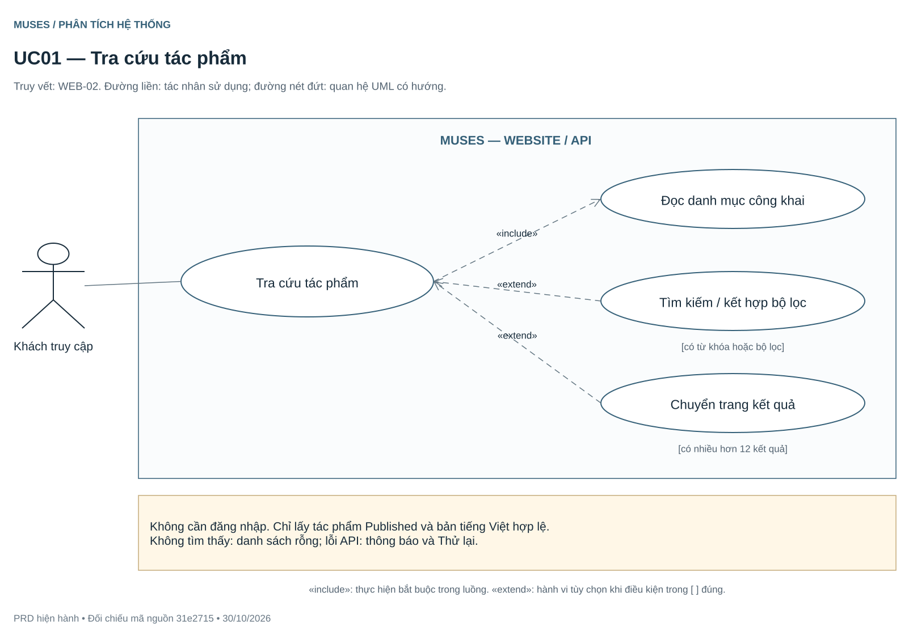

[Mở SVG](diagrams/images/uc01.svg) · [Mở riêng PNG](diagrams/images/uc01.png).

UC02 — Xem chi tiết tác phẩm

**Tác nhân:** Khách truy cập. **Yêu cầu liên quan:** `WEB-03 / WEB-04 / WEB-09`.

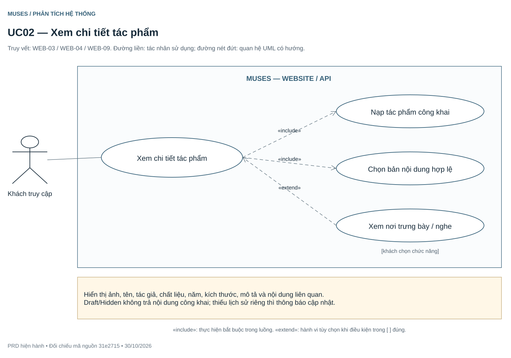

[Mở SVG](diagrams/images/uc02.svg) · [Mở riêng PNG](diagrams/images/uc02.png).

UC03 — Chuyển ngôn ngữ nội dung

**Tác nhân:** Khách truy cập. **Yêu cầu liên quan:** `WEB-04`.

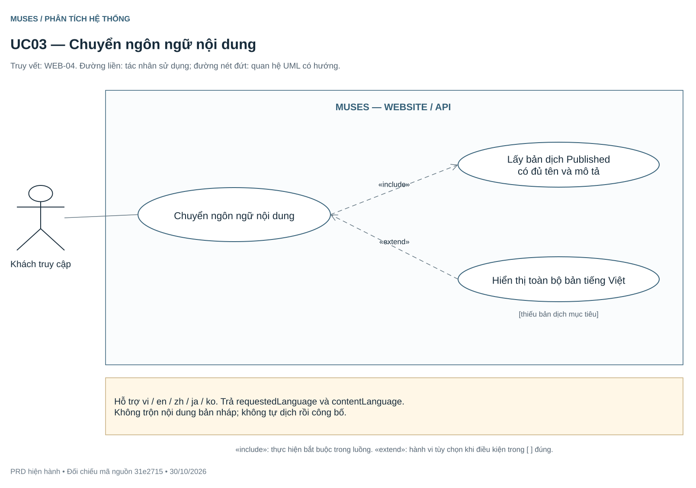

[Mở SVG](diagrams/images/uc03.svg) · [Mở riêng PNG](diagrams/images/uc03.png).

UC04 — Nghe thuyết minh

**Tác nhân:** Khách truy cập. **Yêu cầu liên quan:** `WEB-05 / WEB-06`.

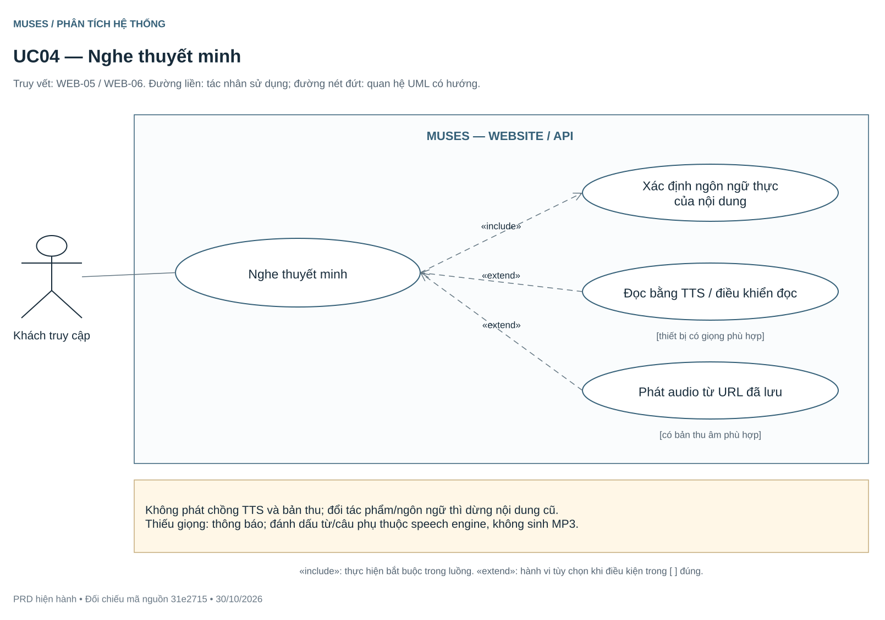

[Mở SVG](diagrams/images/uc04.svg) · [Mở riêng PNG](diagrams/images/uc04.png).

UC05 — Xem nơi trưng bày tác phẩm

**Tác nhân:** Khách truy cập. **Yêu cầu liên quan:** `WEB-09 / BR-03`.

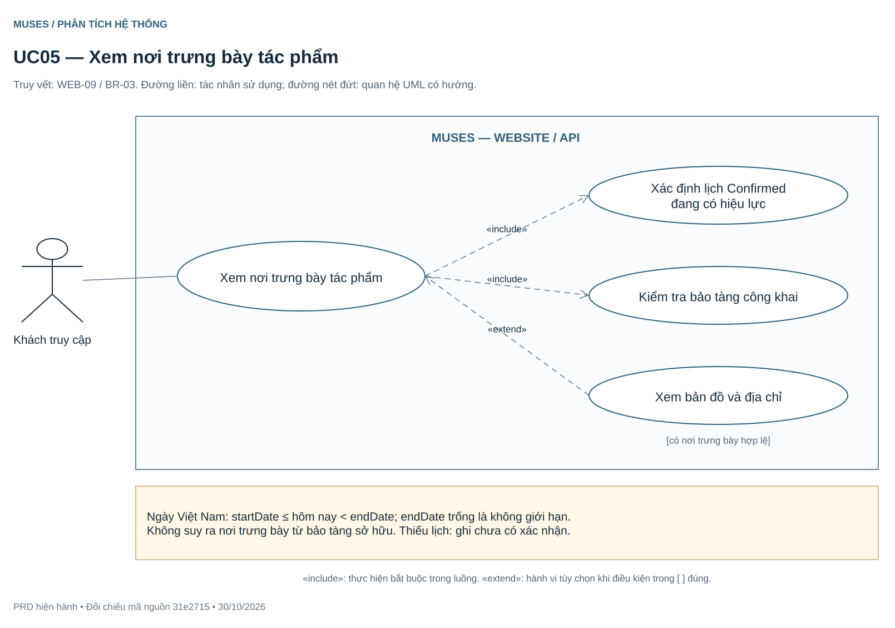

[Mở SVG](diagrams/images/uc05.svg) · [Mở riêng PNG](diagrams/images/uc05.png).

UC06 — Tra cứu bảo tàng tại TP.HCM

**Tác nhân:** Khách truy cập. **Yêu cầu liên quan:** `WEB-10`.

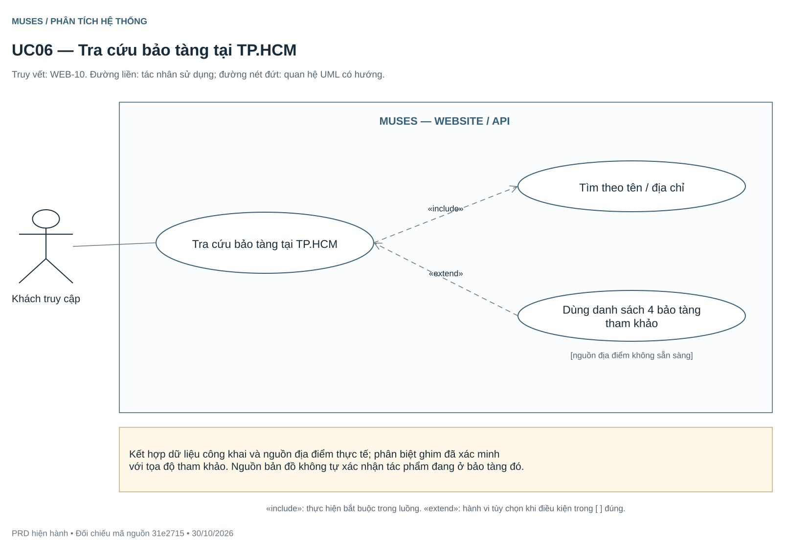

[Mở SVG](diagrams/images/uc06.svg) · [Mở riêng PNG](diagrams/images/uc06.png).

UC07 — Xem bản đồ bảo tàng

**Tác nhân:** Khách truy cập. **Yêu cầu liên quan:** `WEB-10 / WEB-11`.

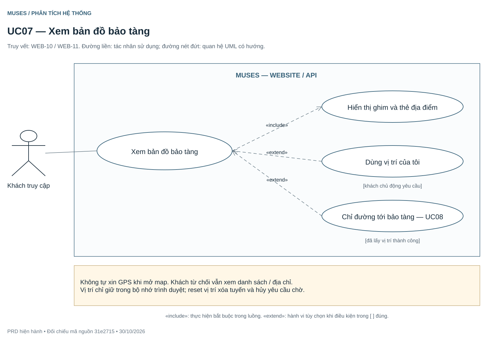

[Mở SVG](diagrams/images/uc07.svg) · [Mở riêng PNG](diagrams/images/uc07.png).

UC08 — Chỉ đường trên bản đồ Muses

**Tác nhân:** Khách truy cập. **Yêu cầu liên quan:** `WEB-11 / BR-04`.

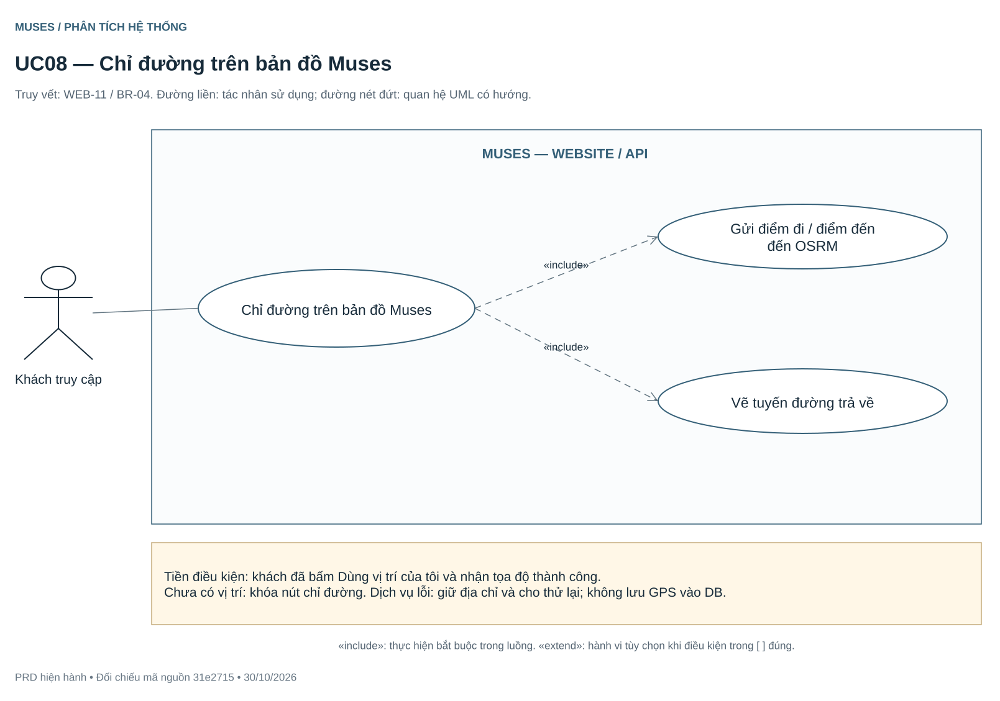

[Mở SVG](diagrams/images/uc08.svg) · [Mở riêng PNG](diagrams/images/uc08.png).

UC09 — Đăng nhập tài khoản web

**Tác nhân:** Khách / Admin. **Yêu cầu liên quan:** `WEB-16 / ADM-01`.

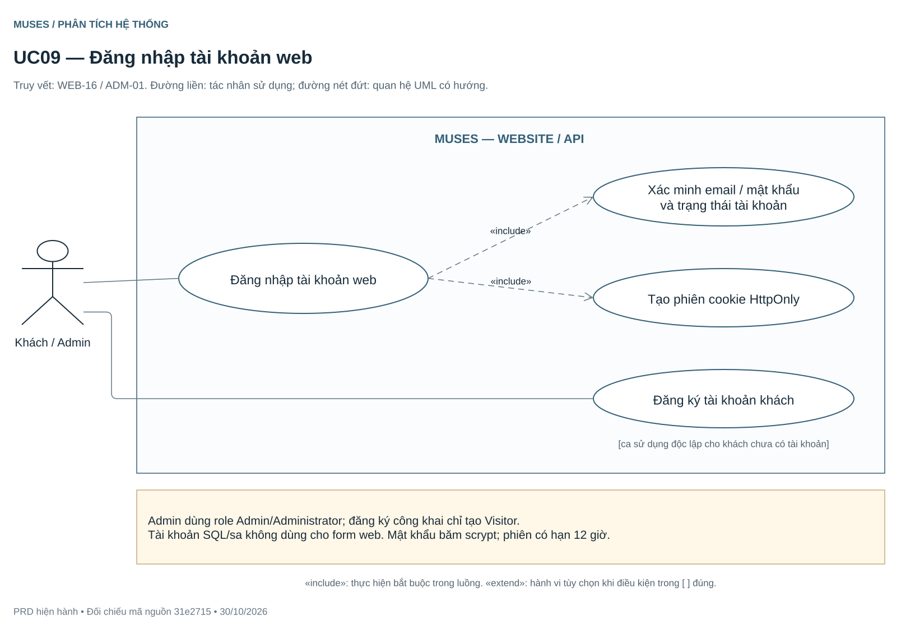

[Mở SVG](diagrams/images/uc09.svg) · [Mở riêng PNG](diagrams/images/uc09.png).

UC10 — Quản lý và công bố tác phẩm

**Tác nhân:** Quản trị viên. **Yêu cầu liên quan:** `ADM-02 / BR-01`.

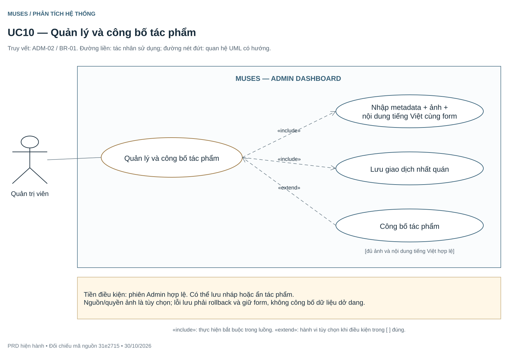

[Mở SVG](diagrams/images/uc10.svg) · [Mở riêng PNG](diagrams/images/uc10.png).

UC11 — Quản lý bản dịch và URL audio

**Tác nhân:** Quản trị viên. **Yêu cầu liên quan:** `ADM-03 / BR-02`.

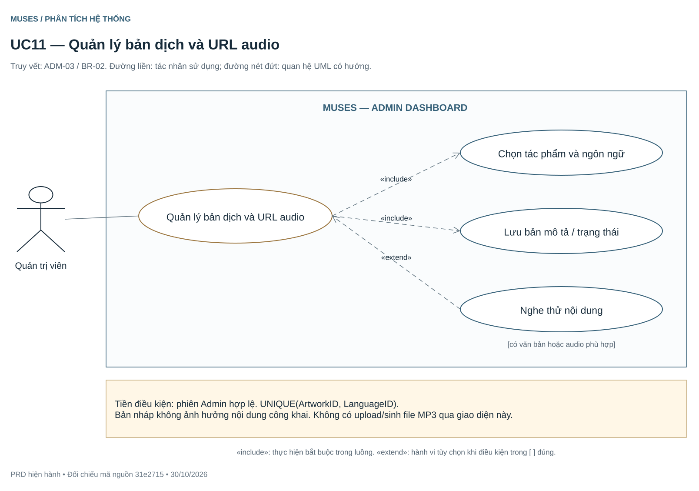

[Mở SVG](diagrams/images/uc11.svg) · [Mở riêng PNG](diagrams/images/uc11.png).

UC12 — Quản lý thông tin bảo tàng

**Tác nhân:** Quản trị viên. **Yêu cầu liên quan:** `ADM-05`.

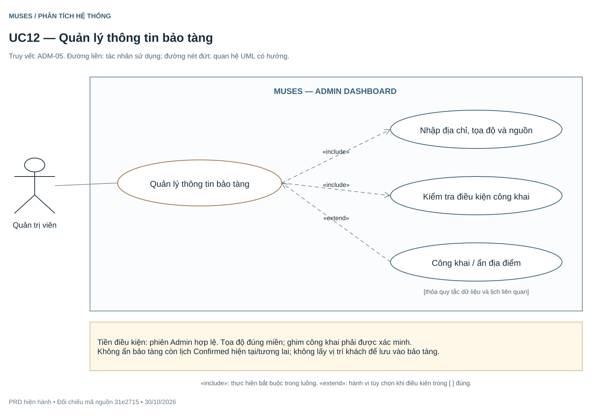

[Mở SVG](diagrams/images/uc12.svg) · [Mở riêng PNG](diagrams/images/uc12.png).

UC13 — Quản lý lịch trưng bày hiện vật

**Tác nhân:** Quản trị viên. **Yêu cầu liên quan:** `ADM-06 / BR-03`.

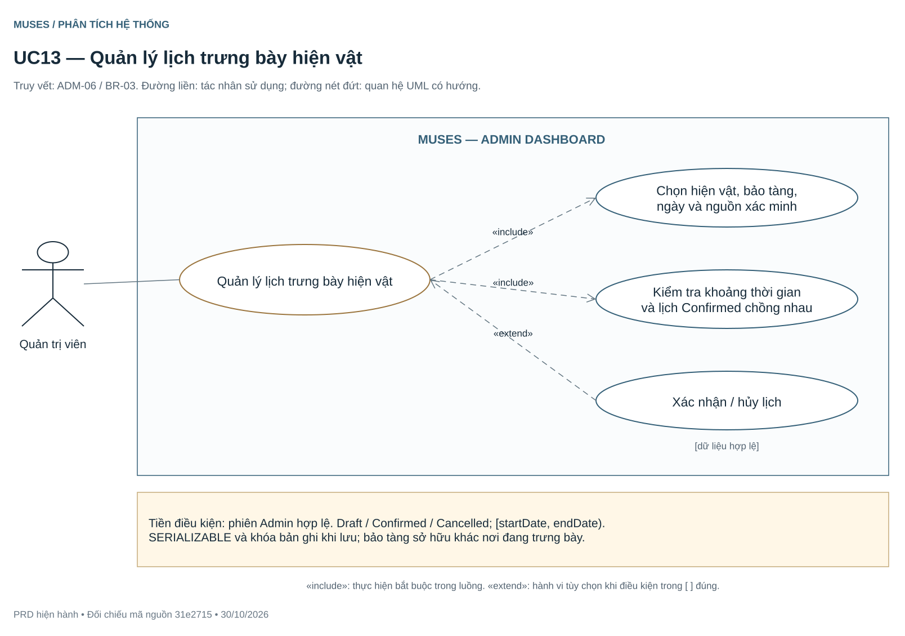

[Mở SVG](diagrams/images/uc13.svg) · [Mở riêng PNG](diagrams/images/uc13.png).

UC14 — Quản lý tác giả, chất liệu, thể loại

**Tác nhân:** Quản trị viên. **Yêu cầu liên quan:** `ADM-04`.

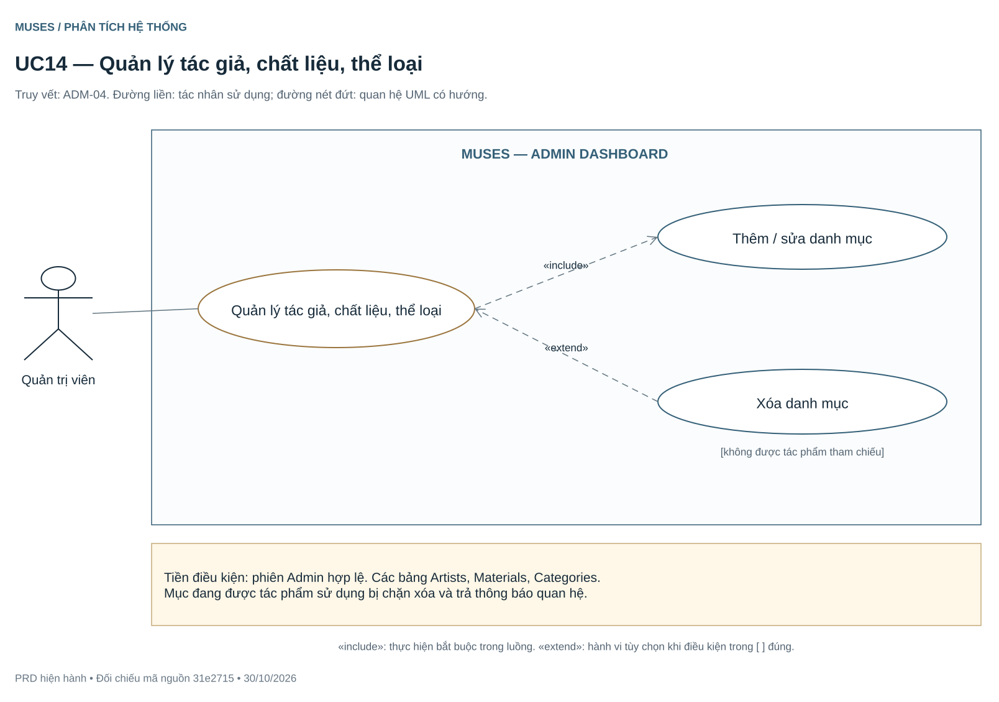

[Mở SVG](diagrams/images/uc14.svg) · [Mở riêng PNG](diagrams/images/uc14.png).

UC15 — Đăng xuất

**Tác nhân:** Khách / Admin. **Yêu cầu liên quan:** `WEB-16 / ADM-01`.

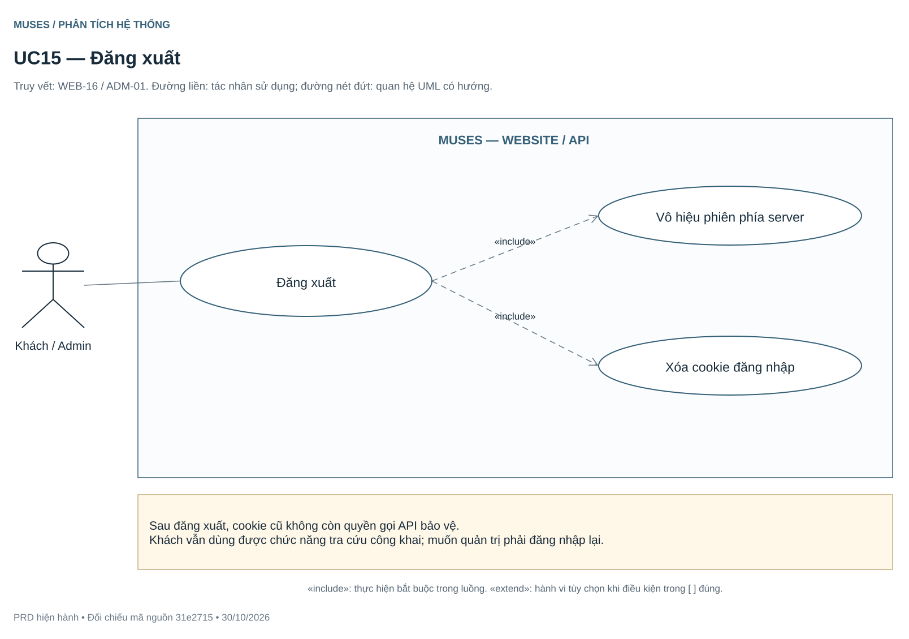

[Mở SVG](diagrams/images/uc15.svg) · [Mở riêng PNG](diagrams/images/uc15.png).

UC16 — Xem và quét QR tác phẩm

**Tác nhân:** Khách truy cập. **Yêu cầu liên quan:** `WEB-07 / WEB-08 / BR-05`.

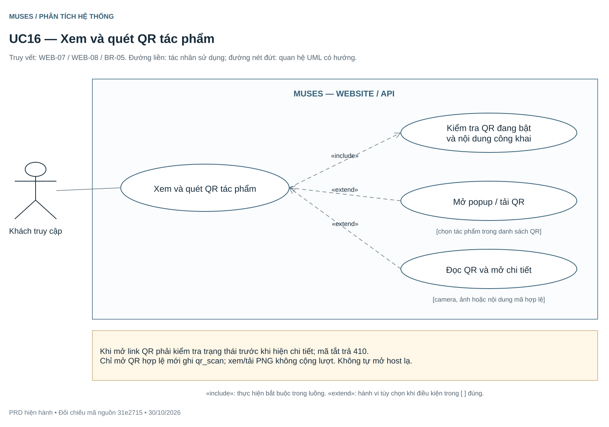

[Mở SVG](diagrams/images/uc16.svg) · [Mở riêng PNG](diagrams/images/uc16.png).

UC17 — Quản lý QR đang hoạt động

**Tác nhân:** Quản trị viên. **Yêu cầu liên quan:** `ADM-07 / BR-05`.

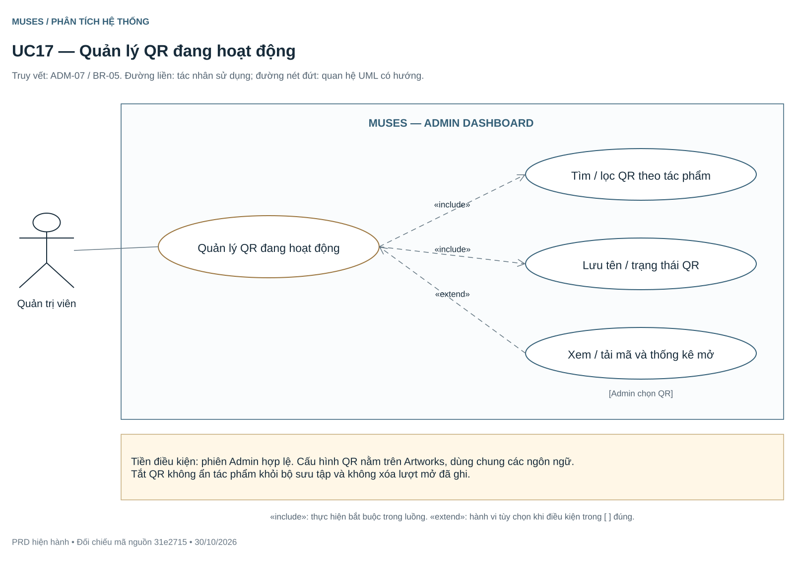

[Mở SVG](diagrams/images/uc17.svg) · [Mở riêng PNG](diagrams/images/uc17.png).

UC18 — Xây dựng lộ trình tham quan

**Tác nhân:** Khách truy cập. **Yêu cầu liên quan:** `WEB-12 / BR-04`.

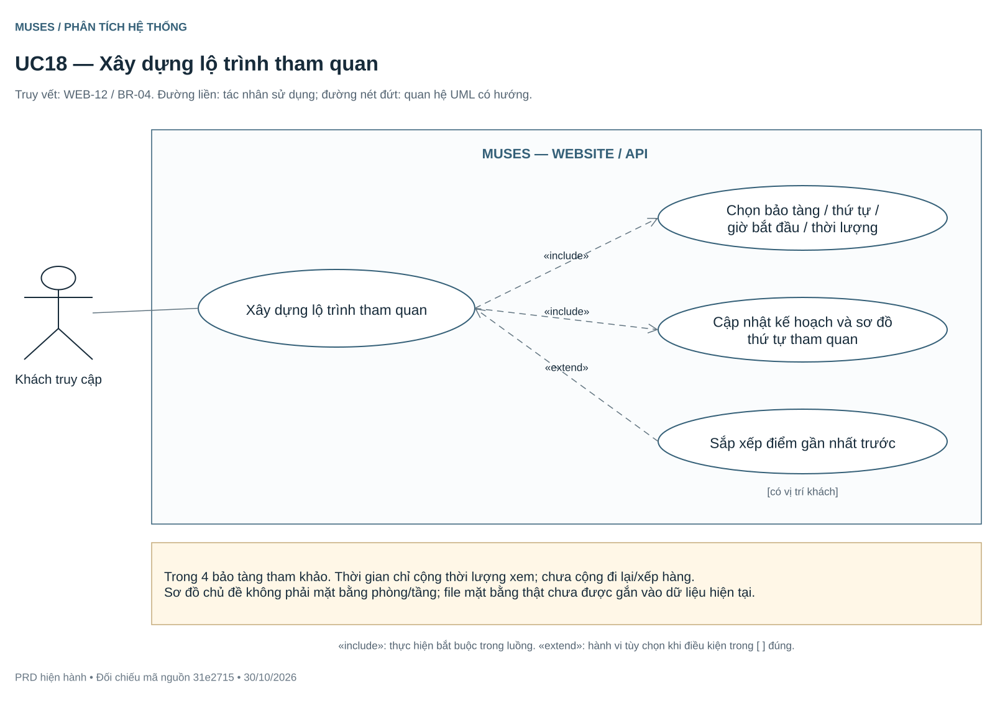

[Mở SVG](diagrams/images/uc18.svg) · [Mở riêng PNG](diagrams/images/uc18.png).

UC19 — Tra cứu giá vé bảo tàng

**Tác nhân:** Khách truy cập. **Yêu cầu liên quan:** `WEB-15 / BR-08`.

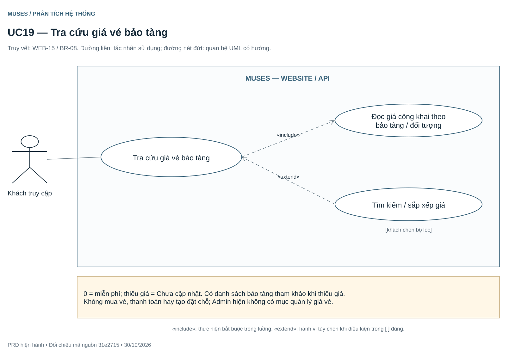

[Mở SVG](diagrams/images/uc19.svg) · [Mở riêng PNG](diagrams/images/uc19.png).

UC20 — Xem Overview và Reports

**Tác nhân:** Quản trị viên. **Yêu cầu liên quan:** `ADM-08 / ADM-09 / BR-06 / BR-07`.

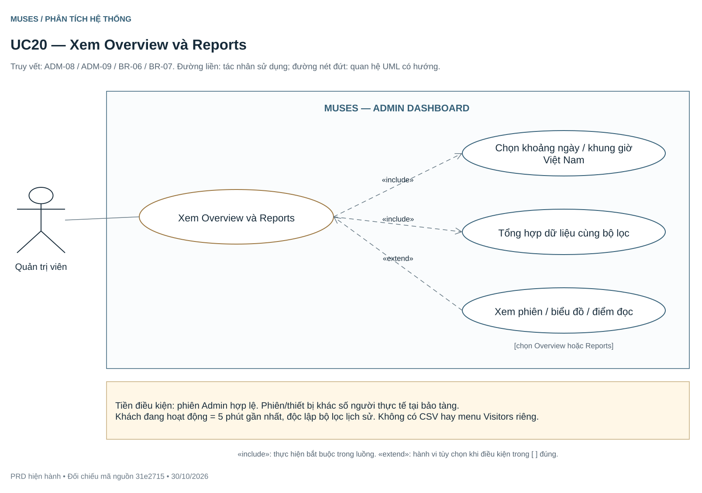

[Mở SVG](diagrams/images/uc20.svg) · [Mở riêng PNG](diagrams/images/uc20.png).

UC21 — Xem thông tin tham quan

**Tác nhân:** Khách truy cập. **Yêu cầu liên quan:** `WEB-01 / WEB-13 / WEB-14`.

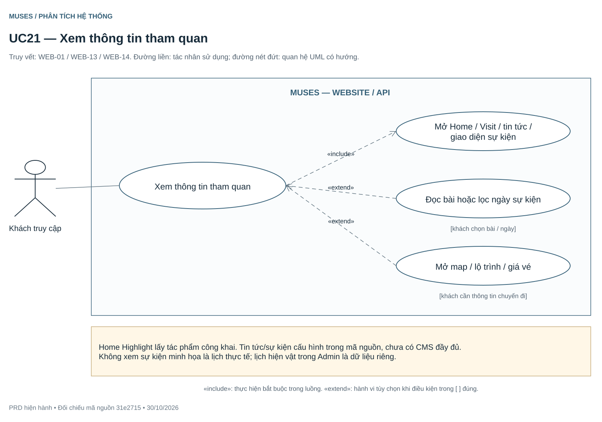

[Mở SVG](diagrams/images/uc21.svg) · [Mở riêng PNG](diagrams/images/uc21.png).

UC22 — Chia sẻ QR truy cập website

**Tác nhân:** Khách truy cập. **Yêu cầu liên quan:** `WEB-17`.

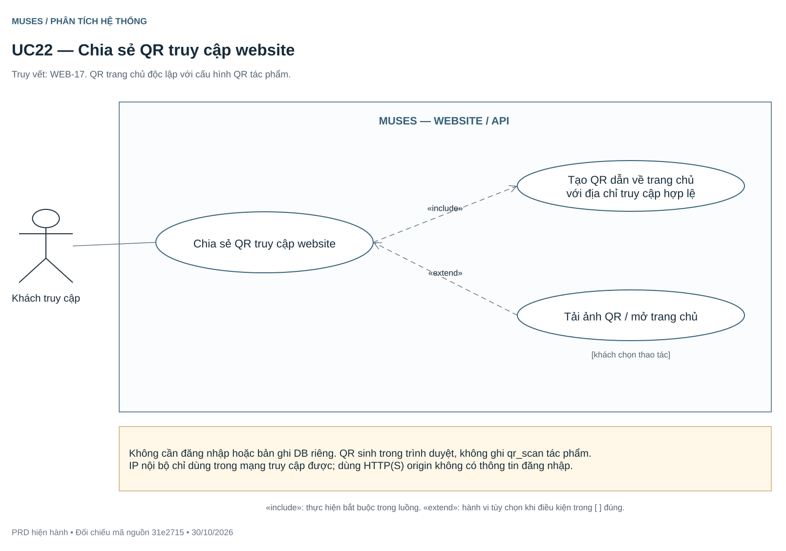

[Mở SVG](diagrams/images/uc22.svg) · [Mở riêng PNG](diagrams/images/uc22.png).

